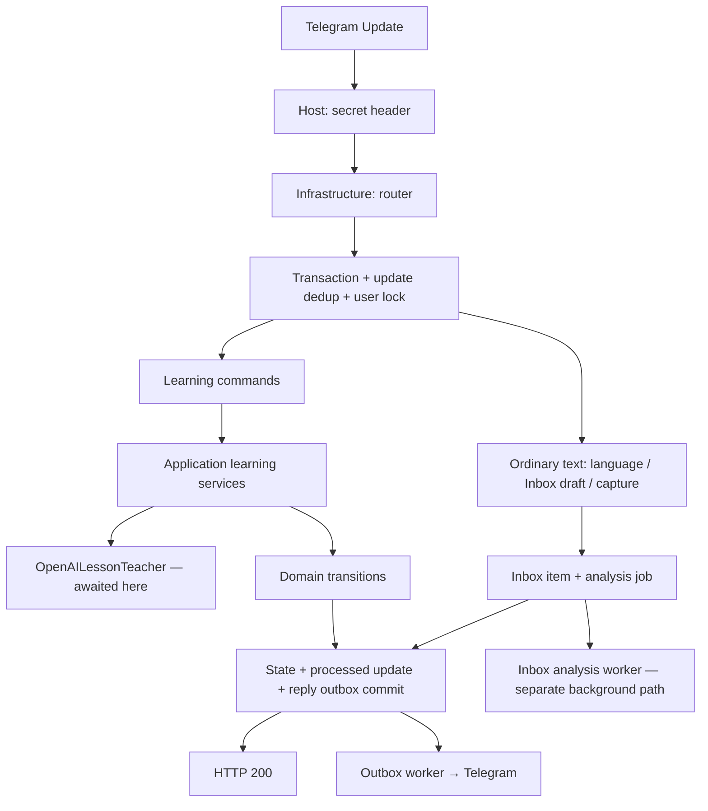
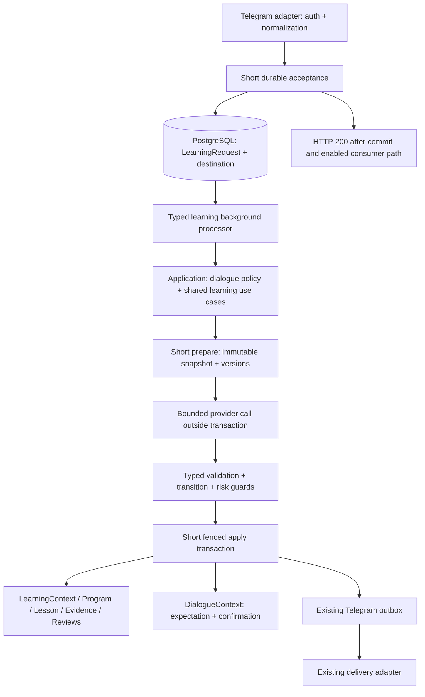

# OwnDay — Product Experience Refactoring: Architecture Review & Implementation Plan

> 2026-11-15: S9 engineering завершён (`2daacd9`), обязательное post-commit review
> без подтверждённых P0–P3. Полный прогон до последней узкой правки маршрутизации:
> 680 integration passed / 2 live skipped, 782 unit passed. После правки:
> Release build 0 warnings/errors, 134 unit и 29 integration passed.
> [Журнал S9](product-experience-s9-log.md), [review](reviews/study-dialogue-review.md).
> Single outbox deliverer сохраняется; claim/lease migration обязательна до scale-out.
>
> S10 не завершён: сопоставимые end-reading и структурированные writing-rubric
> результаты отсутствуют, текущие diagnostic/lesson задания имеют разные критерии.
> Минимальные альтернативы сравнения изучены; критическую сопоставимость
> подтвердить нельзя. S11 требует отсутствующих в изученных источниках данных
> экспертного opt-in pilot и согласованных метрик. Запрошен источник материалов;
> дальнейшая реализация сравнительных утверждений остановлена до их получения
> или проверки сопоставимого набора. Требования не изменены, synthetic fixtures
> не объявляются pilot. [Обоснование и следующие действия](product-experience-comparison-readiness.md).

> S8 engineering завершён: `ed71a8b`, post-commit review относительно `e46894e`
> без подтверждённых P0/P1/P2/P3. Полный прогон: 677 integration passed / 2 live
> skipped, 770 unit passed; Release build без warnings/errors. Внешние release gates
> открыты. Следующий этап S9. [Review S8](reviews/confirmed-program-switch-review.md).

> Повторная проверка 2026-11-15: локальная блокировка тестирования S8 снята.
> После исправления трёх исторических migration fixtures полный нефильтрованный
> Release-прогон: 677 integration passed / 2 live skipped, 770 unit passed;
> build 0 warnings/errors. Commits реализации и post-commit review ещё предстоят.
> Подробности: [журнал S8](product-experience-s8-log.md). Более ранний статус ниже
> сохранён как история диагностики.

> Проверка 2026-11-15: первый незавершённый этап S8. Переданная пользователем
> реализация остаётся незакоммиченной. Release build: 0 warnings/errors; 770 unit
> passed. PostgreSQL-прогоны после подготовки изолированной базы не дали итогового
> результата и остановлены; migration/restart/atomicity не подтверждены. S8 не
> завершён, переход к реализации следующих этапов не выполнен. Подробности и
> дальнейшая диагностика: [журнал S8](product-experience-s8-log.md).

> Продолжение по указанию пользователя: ручная приёмка отложена до завершения
> инженерной реализации всех шагов и не блокирует последующую разработку.
> S6 выполнен автоматически (`3177668`): 648 integration / 762 unit passed,
> два live-набора skipped; post-commit review без подтверждённых замечаний.
> E1 release gates (реальная модель, NVDA, retention/topology) остаются открытыми.
> Следующий инженерный шаг — S7 с отдельным design review. Подробности:
> [журнал S6](product-experience-s6-log.md), [review](reviews/experience-return-review.md).

> Актуализация 2026-11-14: S5 завершён локально — `6e7350b`, review-fix `fbfb400`.
> Повторное post-commit review: подтверждённых P0/P1/P2/P3 не осталось.
> Проверки: 645 integration passed / 1 live smoke skipped, 761 unit passed;
> Release build без warnings/errors. Четыре случая исходного untracked класса
> PostgresLearningRequestTests исключены; дефект его legacy fixture описан в
> [defects.md](defects.md), полный working-tree suite зелёным не объявлен.
> S6/E1 не завершён: обязательные Learning live smoke/test account и ручная
> Telegram Desktop + NVDA приёмка отсутствуют, ключа OpenAI в окружении нет.
> Дальнейшая последовательность остановлена на внешних gates S6; S7–S11 не начаты.
> Результаты, commits, review и необходимые действия:
> [product-experience-s5-log.md](product-experience-s5-log.md),
> [review S5](reviews/english-diagnostic-review.md). Исходные требования и история ниже сохранены.

> Актуализация 2026-11-12: S1.4 проверен (`bbde307`); S1.5 реализован и прошёл
> локальную приёмку (`bb46aed`, `506adc7`). Полная регрессия: 601 integration,
> 728 unit; live smoke пропущен. Test-bot/topology/backfill rollout gates открыты,
> production ingress не включался. Подробности и review: журнал по ссылке ниже.
> Пользователь утвердил общий бюджет сервиса $10 за календарный месяц UTC;
> S2 завершён локально (`0e90153`): общий ledger и $10/месяц UTC; post-commit
> review без оставшихся замечаний. Readiness P2 исправлен в `afe64ee`.
> S3 завершён локально (`e563978`): 632 integration и 754 unit passed,
> один live smoke skipped; post-commit review без подтверждённых замечаний.
> S4 завершён локально (`408df32`, P2 исправлен в `a82385d`): полная регрессия
> 638 integration / 754 unit; финальные проверки 10 integration / 30 unit/model.
> Повторное review без подтверждённых замечаний; live/NVDA gates открыты.
> Следующая реализация — S5. Прежние статусы ниже сохранены как история решений.

> Журнал текущей реализации: [product-experience-implementation-log.md](product-experience-implementation-log.md).
> S1.1 завершён: `dd7c2e2`, `f86d3ed`; post-commit review P2 исправлен,
> P0/P1 не обнаружены. Исходные требования и исторические статусы ниже сохранены.
> S1.2 завершён: `141d56e`, post-commit review без подтверждённых замечаний.
> S1.3 завершён: `5295961`, `34b134d`; post-commit review P1/P2 исправлены,
> повторные проверки пройдены, подтверждённых P0/P1 не осталось.
> Следующий этап: S1.4. Production async ingress ещё выключен.
> 2026-11-12: пользователь отложил test-bot smoke и согласование live-бюджета;
> эти внешние проверки не считаются выполненными. Локальная работа продолжается.

Исследование кода: 2026-11-11; архитектурная редакция и сверка ключевых путей: 2026-11-12. Статус: план с утверждёнными архитектурными решениями, реализация не начата.
Область: исходный код, проекты, релевантные требования и существующие тесты репозитория.
Язык первого продуктового сценария: русский интерфейс, английские учебные материалы и ответы.

## 1. Executive Summary

OwnDay уже имеет пригодное для повторного использования образовательное ядро. Проблема преимущественно в способе его запуска и объединения в пользовательский сценарий. Переписывать Learning или строить рядом агентную образовательную систему не требуется.

**Подтверждено кодом:** программы и версии маршрутов, необязательная однократная диагностика, урок с одним оцениваемым ответом, уточнения, пауза/возобновление, свидетельства знаний, интервальные повторения, предпочтения, приглашения и объяснимый отчёт существуют. Application не зависит от Telegram SDK. Но обычный текст направляется в Inbox, а учебные операции доступны через отдельные команды. `LearningSession` как отдельного типа нет: текущая единица взаимодействия — `Lesson`. Основания: [T2], [L1]–[L7], [D1]–[D6].

**Критический эксплуатационный факт:** `TelegramWebhookController.Post` ожидает `TelegramUpdateHandler.HandleAsync`; обработчик начинает транзакцию, берёт пользовательский `pg_advisory_xact_lock` и лишь затем вызывает учебные use cases. Те ожидают LLM до commit. Следовательно, генерация, оценивание, уточнение и планирование действительно удерживают webhook, транзакцию и блокировку на время внешнего вызова. Адаптация может выполнить два последовательных вызова. [T1], [T2], [L1], [L2], [A1].

**Утверждённая архитектура:** infrastructure first; модульный монолит и существующие доменные переходы сохраняются. `LearningContext` отвечает за педагогическое состояние, отдельный `DialogueContext` — за разговор, ожидания и подтверждения, технический `LearningRequest` — за надёжную обработку. Детерминированные правила обрабатывают очевидные намерения, LLM предлагает типизированное намерение для неоднозначных случаев; код проверяет актуальность, переход и риск. Безопасные однозначные действия автоматические, неоднозначные уточняются, существенные изменения требуют явного подтверждения. Естественный диалог — основной интерфейс; все существующие учебные команды — альтернативный путь к тем же Application use cases. Productivity-команды и явный Inbox сохраняются. Учебный запрос не становится `InboxItem`.

До первого пользовательского релиза необходимы: надёжный асинхронный вход, учёт и ограничение LLM, диалог без команд, консультация, короткая диагностика/пропуск, первый английский урок, уточнение, пауза и восстановление. Это **первый продуктовый milestone E1**, поставляемый небольшими инженерными изменениями S1.1–S1.5 и S2–S6 из раздела 10. Не следует объединять их в один большой PR. E1 не включает доказанную оценку CEFR, голосовой интерфейс, универсальный агентный framework или автоматическое завершение реальных задач.

**Границы доказательств:** при исходном исследовании каталог был чистым; на начало этой редакции уже существовал только untracked `docs/product-experience-refactoring-plan.md`. Его исследовательские результаты и ссылки сохранены. Сборка, тесты, live LLM и Telegram в документальном задании не запускались; наличие тестов не доказывает их прохождение. Все новые модели и механизмы ниже — план. Изменяется только документ; production-код, тесты, миграции, конфигурация и история Git не меняются.

## 2. Current Architecture

### 2.1. Источники и обозначения

Ссылки ниже служат адресами доказательств для последующих таблиц; рядом с выводами указаны конкретные методы. Документация [learning acceptance](phase-5/acceptance.md), [learning requirements](phase-5/phase-5-requirements.md), [Telegram UX](features/telegram/ux.md), [Inbox background](features/inbox/background-processing.md), [cost control](features/inbox/observability-and-cost-control.md) использована как требования и контекст, а не доказательство реализации. Старые [Product Vision](product/OwnDay-Product-Vision.md), [PRD](product/OwnDay-Product-Requirements.md) и [MVP Architecture](design/OwnDay-MVP-Architecture.md) описывают accountability; новая концепция пользователя имеет приоритет для этого плана. Из них нельзя выводить наличие Commitment или других отсутствующих механизмов.

| ID | Исходник и ключевые точки |
|---|---|
| T1 | [TelegramWebhookController](../src/OwnDay.Host/Controllers/TelegramWebhookController.cs), `Post`; [TelegramWebhookAuthorizationFilter](../src/OwnDay.Host/Filters/TelegramWebhookAuthorizationFilter.cs), `OnAuthorization`, `HasValidWebhookSecret` |
| T2 | [TelegramUpdateHandler](../src/OwnDay.Infrastructure/Telegram/Handling/TelegramUpdateHandler.cs), `HandleAsync`, `HandleRoutedAsync`, `ServiceReply` |
| T3 | [TelegramUpdateRouter](../src/OwnDay.Infrastructure/Telegram/Routing/TelegramUpdateRouter.cs), `Route`; [TelegramCommandParser](../src/OwnDay.Infrastructure/Telegram/Commands/TelegramCommandParser.cs), `Parse` |
| T4 | [TelegramInboxFlow](../src/OwnDay.Infrastructure/Telegram/Handling/TelegramInboxFlow.cs), `CaptureAsync`, `CaptureOrContinueAsync`; [TelegramLanguageFlow](../src/OwnDay.Infrastructure/Telegram/Handling/TelegramLanguageFlow.cs) |
| T5 | [TelegramCurriculumCommandHandler](../src/OwnDay.Infrastructure/Telegram/Commands/TelegramCurriculumCommandHandler.cs), `HandleAsync`; [TelegramLearningPresenter](../src/OwnDay.Infrastructure/Telegram/Commands/TelegramLearningPresenter.cs), `Render`; [TelegramProgressPresenter](../src/OwnDay.Infrastructure/Telegram/Commands/TelegramProgressPresenter.cs) |
| L1 | [LearningService](../src/OwnDay.Application/Learning/LearningService.cs), `StartAsync`, `AnswerAsync`, `ClarifyAsync`, `PauseAsync`, `ResumeAsync`, `FinishAsync`; контракты `ILessonTeacher`, `ILessonStore` |
| L2 | [CurriculumService](../src/OwnDay.Application/Learning/CurriculumService.cs), `CreateAsync`, `DiagnoseAsync`, `NextAsync`, `AdaptAsync`, `StartLessonAsync`, `SelectAsync`; `ICurriculumPlanner`, `ICurriculumStore` |
| L3 | [AdaptiveTeaching](../src/OwnDay.Application/Learning/AdaptiveTeaching.cs), `TryValidate`, `StrategyFor`, `ITeachingPlanner` |
| L4 | [KnowledgeService](../src/OwnDay.Application/Learning/KnowledgeService.cs), `AttachAsync`, `RecordAnswerAsync`, `StatusAsync`, `ConfirmTopicAsync`, `ReviewsAsync` |
| L5 | [KnowledgeService.Personalization](../src/OwnDay.Application/Learning/KnowledgeService.Personalization.cs), `PersonalizationAsync`, `SetPreferenceAsync`, `ForGeneration` |
| L6 | [StudyService](../src/OwnDay.Application/Learning/StudyService.cs), `ConfigureAsync`, `PlanAsync`, `StartAsync`, `CanDeliver`, `DismissAsync` |
| L7 | [CurriculumService.Progress](../src/OwnDay.Application/Learning/CurriculumService.Progress.cs), `ProgressAsync`; [Project](../src/OwnDay.Application/Learning/CurriculumService.Project.cs), `ProjectPracticeAsync`; [Transfer](../src/OwnDay.Application/Learning/CurriculumService.Transfer.cs), `TransferPracticeAsync` |
| D1 | [LearningProgram и CurriculumRoute](../src/OwnDay.Domain/Learning/LearningProgram.cs), `Create`, `ApplyDiagnostic`, `SkipDiagnostic`, `ProposeAdaptation`, `ApplyAdaptation`, `ProgressVersions` |
| D2 | [Lesson](../src/OwnDay.Domain/Learning/Lesson.cs), `Start`, `Complete`, `AddExplanation`, `Pause`, `Resume`, `Finish`; [LessonInteraction](../src/OwnDay.Domain/Learning/LessonInteraction.cs) |
| D3 | [LearningEvidence и LearnerSkillState](../src/OwnDay.Domain/Learning/LearningEvidence.cs), `FromAnswer`, `Evaluate`; [Skill](../src/OwnDay.Domain/Learning/Skill.cs), `Create` |
| D4 | [LessonVerification](../src/OwnDay.Domain/Learning/LessonVerification.cs), `LessonProvenance.Validate`, `NormalizedTextAnswerCheck.Check` |
| D5 | [ReviewSchedule](../src/OwnDay.Domain/Learning/ReviewSchedule.cs), `Record`, `Defer`; [StudySchedule](../src/OwnDay.Domain/Learning/StudySchedule.cs), `Configure`, `Invite`, `NextWindow` |
| D6 | [LearningContext](../src/OwnDay.Domain/Learning/LearningContext.cs), `Create`, `Select`; [LearningPreference](../src/OwnDay.Domain/Learning/LearningPreference.cs); [ProgramSkillLink](../src/OwnDay.Domain/Learning/ProgramSkillLink.cs), `Confirm` |
| A1 | [OpenAILessonTeacher](../src/OwnDay.Infrastructure/OpenAIAnalysis/OpenAILessonTeacher.cs), `RequestAsync`, `GenerateAsync`, `AssessAsync`, `ExplainAsync`, `PlanAsync`, `ProposeAsync` |
| A2 | [RfcLessonSourceReader](../src/OwnDay.Infrastructure/OpenAIAnalysis/RfcLessonSourceReader.cs), `ReadAsync`, `RetrievedLessonSource.Provenance` |
| P1 | [EfLessonStore](../src/OwnDay.Infrastructure/Persistence/EfLessonStore.cs); [EfCurriculumStore](../src/OwnDay.Infrastructure/Persistence/EfCurriculumStore.cs), `CompletedTopicsAsync`; [EfKnowledgeStore](../src/OwnDay.Infrastructure/Persistence/EfKnowledgeStore.cs), `TopicStatusesAsync`, `EvidenceAsync`, `StrategyObservationsAsync` |
| P2 | [OwnDayDbContext](../src/OwnDay.Infrastructure/Persistence/OwnDayDbContext.cs), `OnModelCreating`; [CurriculumModel](../src/OwnDay.Infrastructure/Persistence/CurriculumModel.cs); [KnowledgeModel](../src/OwnDay.Infrastructure/Persistence/KnowledgeModel.cs); [StudyModel](../src/OwnDay.Infrastructure/Persistence/StudyModel.cs) |
| B1 | [InboxAnalysisJob](../src/OwnDay.Application/Inbox/Analysis/InboxAnalysisJob.cs), `Schedule`, `Finish`, `IInboxAnalysisJobStore`, `RetryAfter`; [InboxAnalysisService](../src/OwnDay.Application/Inbox/Analysis/InboxAnalysisService.cs), `ProcessJobAsync` |
| B2 | [InboxAnalysisWorker](../src/OwnDay.Infrastructure/OpenAIAnalysis/InboxAnalysisWorker.cs), `RunAsync`, `RecoverAsync`, `ApplyAsync`; [EfInboxAnalysisJobStore](../src/OwnDay.Infrastructure/Persistence/EfInboxAnalysisJobStore.cs), `ClaimAsync`, `StartAsync`, `FinishAsync`, `LockAsync` |
| B3 | [InboxCaptureService](../src/OwnDay.Application/Inbox/InboxCaptureService.cs), `CaptureAsync`; [EfInboxItemStore](../src/OwnDay.Infrastructure/Persistence/EfInboxItemStore.cs), `AddAsync` |
| O1 | [TelegramOutboxDeliveryService](../src/OwnDay.Infrastructure/Telegram/Delivery/TelegramOutboxDeliveryService.cs), `DeliverBatchAsync`; [TelegramOutboxWorker](../src/OwnDay.Infrastructure/Telegram/Delivery/TelegramOutboxWorker.cs); [TelegramOutboxMessage](../src/OwnDay.Infrastructure/Persistence/TelegramOutboxMessage.cs) |
| O2 | [StudyInvitationDispatcher](../src/OwnDay.Infrastructure/Telegram/Delivery/StudyInvitationDispatcher.cs), `DispatchBatchAsync`; [StudyInvitationWorker](../src/OwnDay.Infrastructure/Telegram/Delivery/StudyInvitationWorker.cs) |
| C1 | [CostControlledInboxAnalyzer](../src/OwnDay.Application/Inbox/Observability/CostControlledInboxAnalyzer.cs), `AnalyzeAsync`; [OpenAIRequestAttempt и OpenAICostOptions](../src/OwnDay.Application/Inbox/Observability/OpenAIRequestAttempt.cs) |
| C2 | [EfOpenAIRequestLedger](../src/OwnDay.Infrastructure/Persistence/EfOpenAIRequestLedger.cs), `AdmitAsync`, `FinishAsync`; [InboxObservabilityModel](../src/OwnDay.Infrastructure/Persistence/InboxObservabilityModel.cs) |
| W1 | [Program](../src/OwnDay.Host/Program.cs); [Telegram registrations](../src/OwnDay.Infrastructure/Telegram/TelegramServiceCollectionExtensions.cs), `AddTelegram`; [Inbox registrations](../src/OwnDay.Infrastructure/OpenAIAnalysis/InboxAnalysisServiceCollectionExtensions.cs), `AddInboxAnalysis` |

### 2.2. Слои и фактический путь сообщения

Направления `Host → Application, Infrastructure`, `Infrastructure → Application`, `Application → Domain` соблюдены в `.csproj`: [Host](../src/OwnDay.Host/OwnDay.Host.csproj), [Infrastructure](../src/OwnDay.Infrastructure/OwnDay.Infrastructure.csproj), [Application](../src/OwnDay.Application/OwnDay.Application.csproj), [Domain](../src/OwnDay.Domain/OwnDay.Domain.csproj). Domain не имеет solution-зависимостей; Telegram.Bot и OpenAI находятся в Infrastructure. Общие .NET 10, nullable, warnings-as-errors и code style заданы в [Directory.Build.props](../Directory.Build.props).

1. Авторизация выполняется до model binding: отсутствующий, неверный и множественный secret header отклоняются; сравнение fixed-time. [T1]
2. Router принимает личные текстовые сообщения и ограниченные callback-конверты; неподдерживаемые обновления игнорируются. Парсинг slash-команд детерминированный, без LLM. [T3]
3. Для обработанного update вставляется уникальный `update_id`, берётся advisory lock пользователя. Обычная транзакция ReadCommitted, для `/stats` — RepeatableRead с ограниченным повтором serialization failure. [T2]
4. Обычный текст обслуживает выбор языка/редактор Inbox либо становится новым Inbox item. Проверки «это ответ на урок?» нет даже при активном `Lesson`. `EfInboxItemStore.AddAsync` сразу создаёт также `InboxAnalysisJob`. [T2], [T4], [B3]
5. Учебные команды вызывают transport-independent сервисы; инфраструктурные presenters создают сообщения. Domain mutation, отметка update и исходящие intents коммитятся атомарно. Сами сервисы Learning не открывают и не завершают transaction. [T2], [L1], [L2]
6. После commit webhook ещё может ждать удаления сообщения slash-команды/подтверждения callback. Обычный текст сохраняется в Telegram. Outbox worker отправляет ответы отдельно, с backoff. [T2], [O1]

### 2.3. Модель и границы агрегатов

| Существующий объект | Ответственность и инварианты | Ограничение для продукта |
|---|---|---|
| `LearningProgram` + принадлежащие ему `CurriculumRoute` | Цель, опыт, дисциплина; 1–12 тем, уникальные коды, существующие prerequisite, ацикличность; исторические версии; диагностика не меняет дисциплину; адаптация сохраняет цель и идентичность прогресса. [D1] | Цель не редактируется; `Priority = 1`; нет lifecycle программы. Диагностика — один вопрос/ответ; адаптация переставляет существующие темы. |
| `Lesson` + `LessonInteraction` | Один вопрос, один итоговый ответ; AwaitingAnswer/Paused/Completed/Finished; изменение состояния через методы; уточнения не заменяют вопрос; связи с владельцем, программой и навыком проверяются. [D2] | Это упражнение, а не многошаговое занятие. Нет времени начала/активности и степени помощи. |
| `Skill` + `LearningEvidence` | Skill — идентичность навыка конкретного пользователя; Evidence — отдельная оценённая попытка, PK `LessonId`, ответ, источник, feedback, время, review и конфликт проверок. [D3], [P2] | Не процент знаний и не каталог CEFR. Одна evidence на урок ограничивает хранение нескольких независимых оценок одной попытки. |
| `LearnerSkillState` | Вычисляемый результат по уникальным урокам: Unknown, NeedsPractice, Developing, Conflicting, Demonstrated; три положительные оценки дают Demonstrated. [D3] | Нет различения помощи, возраста evidence и устойчивого разрешения исторического противоречия. |
| `LearningContext` | Один выбранный `ProgramId` на пользователя, owner-check при выборе. [D6] | Хранит только выбранность программы; разговор не моделируется. Знакомство до программы и ожидания следует хранить отдельно в DialogueContext, не делать ProgramId nullable ради UI. |
| `ReviewSchedule` | Отдельное состояние повторения навыка; конфликт не даёт больший интервал; ранняя практика не переносит due; интервалы после due review — 3/7/14/30 дней. [D5] | Успешный ответ с помощью не отличается от самостоятельного. |
| `StudySchedule` | Одна настройка на пользователя: timezone, 1–4 окна, период 1–30 дней, пауза, актуальная invitation; учтены DST gap/overlap. [D5] | Нет полноценного согласования уведомлений диалогом; пауза урока блокирует приглашения, поскольку урок остаётся active. |
| `LearningPreference`, `LessonTeaching`, `ProgramSkillLink` | Явные предпочтения, snapshot стратегии, подтверждённое общее тождество навыка, без автоматического семантического слияния. [D6] | Предпочтения формата/темпа не заменяют длительность занятия, уведомления или предметный профиль. |

EF mapping использует закрытые setters, FK с владельцем, уникальный активный `Lesson` на пользователя (`Status IN (0,1)`), уникальную evidence на урок и версии маршрута на программу. Это полезная дополнительная защита; она не заменяет пользовательскую сериализацию и транзакционную оркестрацию. [P2]

## 3. Functional Gap Analysis

Состояние относится ко всему целевому сценарию: **Implemented** — полный сценарий подтверждён кодом; **Partially implemented** — есть существенная часть; **Missing** — целевого поведения нет; **Unverified** — достоверных данных недостаточно. Необнаружение механизма в исследованных production-путях обозначено Missing; фактическая live-доступность и педагогическая эффективность остаются Unverified. P0 — нужно для E1/его надёжности; P1 — следующий полноценный опыт; P2 — последующее улучшение. Complexity — относительная сложность полной указанной доработки.

| № / целевой сценарий | Состояние и подтверждённая реализация | Ограничение / чего нет | Минимальное изменение и повторное использование | Приоритет / сложность |
|---|---|---|---|---|
| 1. Приветствие и примеры целей | **Partially implemented.** `TelegramUpdateHandler.ServiceReply` отвечает на `/start`, есть локализованные ресурсы и выбор языка. [T2], [T4] | Приветствие про capture/Inbox; нет первого контакта как преподавателя, знакомства без команд и образовательных примеров. | Краткий педагогический welcome при первом принятом сообщении или Telegram Start; не повторять его на каждое сообщение; переиспользовать locale и outbox. Открытие пустого чата без update не обнаруживается сервером. | P0 / Low |
| 2. Выбор направления диалогом | **Missing.** Нет use case консультации/intent resolver; `CurriculumService.CreateAsync` получает уже готовую цель. [L2], [T2] | Непонятное направление не уточняется; свободный текст уходит в Inbox. | Ограниченный диалог ClarifyDirection в Application, examples/options и сохранённый ожидаемый ответ; затем существующий `CreateAsync`. | P0 / Medium |
| 3. Практическая цель с помощью преподавателя | **Missing.** Поля `Goal`, `Experience` и валидация есть; помощь сформулировать цель отсутствует. [D1], [L2] | Пользователь вводит `goal | experience`; нет выявления практического применения и критерия результата. | 1–2 уточнения, понятная переформулировка цели; хранить проект цели до создания программы. Не вводить Goal aggregate/обязательный Project. | P0 / Medium |
| 4. Короткая адаптивная диагностика / пропуск | **Partially implemented.** `CreateAsync`, `DiagnoseAsync`, `SkipDiagnostic`, `ApplyDiagnostic`. [L2], [D1] | Один optional AI-вопрос; после ответа новый вопрос запрещён; нет нескольких попыток, выбора следующего задания и предметной рубрики. | Ограничить E1 двумя-тремя заданиями по чтению/письму, хранить каждый ход в существующей программе как diagnostic snapshot/owned values; route revise один раз в конце. Пропуск в любой момент, без выдуманного уровня. | P0 / Medium |
| 5. Самостоятельная программа и корректировки | **Partially implemented.** `CreateAsync` сразу создаёт/выбирает маршрут без утверждения плана; `NextAsync`, `AdaptAsync`, `ProposeAdaptation`. [L2], [D1] | Запуск/адаптация преимущественно командные; автоадаптация только при `RepeatedDifficulty`; нельзя добавлять/удалять темы, изменить цель. | Автоматически звать существующий Next после готовности; использовать проверяемую адаптацию. Позже добавить адресную revision тем с явной совместимостью progress; подтверждать только существенную смену цели. | P0 базовый / P1 расширение; High |
| 6. Адаптивное занятие с измеримой целью | **Partially implemented.** `StartLessonAsync` учитывает program goal, skill state, feedback, предпочтения; `AnswerAsync` записывает evidence. [L1]–[L5] | Один вопрос = завершённый урок. Topic title не является измеримой целью; нет цепочки упражнений и критерия успешности занятия. | В E1 озвучить конкретный результат текущего упражнения, критерий и следующий шаг; хранить структурированные objective/criterion у материала. Многошаговые занятия проектировать отдельно после E1; Lesson остаётся упражнением. | P0 минимум / P1 полное; High |
| 7. Контекстный выбор педагогического действия | **Partially implemented.** Шесть `TeachingAction`, `ITeachingPlanner.ProposeAsync`, `AdaptiveTeaching.TryValidate`; объяснение через `ExplainAsync`. [L1]–[L3] | Hint/Explain/Simplify при адаптации генерируют следующий Lesson; нет полноценного выбора действия на каждом ходе и отдельного запроса подсказки к текущему вопросу. | Диалоговый allowlist вызывает existing clarify/next/adapt; отдельный безопасный hint к текущему Lesson с учётом помощи; deterministic guards для темы/prerequisite/состояния. | P0 базовый / P1 полный; High |
| 8. Уточнения и временные отклонения | **Partially implemented.** `ClarifyAsync` → `Lesson.AddExplanation`; prompt `ExplainAsync` допускает detour и возврат к вопросу; presenter печатает исходный вопрос. [L1], [D2], [A1], [T5] | Требуется `/learn_ask`; вопрос «Почему?» не распознаётся. Предыдущие interactions не загружаются `EfLessonStore` и не отправляются провайдеру. | Classify Answer/Clarify/Detour; bounded history + тот же LessonId/Question; неоднозначность уточнять. Переиспользовать explanation/result, не менять цель и не записывать assessment. | P0 / Medium |
| 9. Подтверждение существенной смены цели | **Missing.** `Goal` сохраняется при диагностике и адаптации, но отдельного процесса смены нет. [D1] | Нет pending proposal, подтверждения, expiration/version binding. Защита от смены сейчас — отсутствие операции. | В E1 обнаруживать намерение и спрашивать подтверждение, не менять цель автоматически. В полном сценарии — immutable предложение с base version, подтверждение/отмена; существующая evidence не переписывается. | P0 guard / P1 применение; Medium |
| 10. Гибкая продолжительность | **Partially implemented.** `PauseAsync`, `ResumeAsync`, `FinishAsync` разрешают остановку между ответами и сохраняют вопрос. [L1], [D2] | Нет желаемого времени, timestamps занятия, выбора объёма/короткого продолжения. Pace — текстовое предпочтение, не таймер. | Для E1 «на сегодня хватит» сохраняет unfinished Lesson. Желаемый объём многошагового занятия проектировать отдельно после E1; новый LearningSession сейчас не вводить. | P0 пауза / P1 длительность; Medium |
| 11. Уместное предложение завершить и сохранение | **Partially implemented.** Pause сохраняет незавершённый вопрос, Complete сохраняет ответ/evidence, Finish завершает без оценки. [D2], [L4] | Нет политики «предложить закончить», summary и точки возвращения к цепочке заданий. Finish необратимо убирает урок из active. | Для перерыва использовать Pause, а не Finish. После результата предлагать продолжение/завершение по времени и ходу занятия; сохранять resume point и краткие достигнутые результаты. | P0 сохранность / P1 политика; Medium |
| 12. Возвращение после перерыва | **Partially implemented.** `ResumeAsync`, active `Lesson`, LearningContext и EF persistence; reviews имеют `ObservedAt`, `DueAt`. [L1], [D3], [D5], [P1] | Нет намерения «Продолжим», длительности перерыва, recap и fresh check. Возвращается вопрос, но не весь предыдущий диалог. | E1 — тот же Lesson после restart, bounded recap, без нового Generate и без повторной evidence. Позже выбирать recap/retrieval по давности и due reviews. | P0 / Medium |
| 13. Инициативные занятия и повторения | **Partially implemented.** `StudyService.PlanAsync`, schedule windows/timezone/pause, review-first, dispatcher+outbox, `CanDeliver` повторно проверяет актуальность. [L6], [D5], [O2], [O1] | Настройка длинной командой; paused Lesson подавляет приглашения; нет диалогового согласия/quiet policy для resume reminders. | Согласовать окна/частоту/паузу естественными фразами; повторно использовать scheduler и invitation IDs, отдельно решить приглашение к paused lesson. Не слать до opt-in. | P1 / Medium |
| 14. Достоверная оценка знаний | **Partially implemented.** `Complete`, `FromAnswer`, `LearnerSkillState.Evaluate`, Source/Method, review; нормализованное сравнение, `Conflict`, provenance. [D2]–[D5], [L4] | AI эталон не независим; нет помощи/попыток до подсказки; открытое письмо оценивается binary IsCorrect; диагностика не является skill evidence. | E1 — фиксировать помощь/происхождение, различать предварительную оценку и независимую проверку; независимые авторские reading checks, writing rubric. Позже калибровка и разрешение противоречий. | P0 честность / P1 расширение; High |
| 15. Прогресс через достижения | **Partially implemented.** `ProgressAsync`, `TopicProgress`, `StatusAsync`, `TelegramProgressPresenter`; отмечены evidence/источник/время/due, зачёт темы отделён от mastery. [L4], [L7], [T5] | Нет диалогового запроса прогресса, практической рубрики и baseline; три положительные оценки не доказывают уровень языка. Реальная точность Unverified. | E1 — показать конкретный выполненный reading/writing результат и неопределённость; P1 — сравнимые проверки до/после, самостоятельные delayed ответы, readable evidence-based summary. | P0 feedback / P1 прогресс; Medium |

Ни один из 15 целевых сценариев целиком не подтверждён как Implemented в требуемом естественном UX. Это не отменяет Implemented-механизмы внутри них. Проверка настоящего Telegram со скринридером, задержек настоящего LLM, качества классификации и обучающего эффекта имеет состояние **Unverified**.

## 4. Architecture Review Findings

### Critical

**F01 — внешний LLM внутри webhook transaction/user lock.** Локация: `TelegramWebhookController.Post` → `TelegramUpdateHandler.HandleRoutedAsync` → `LearningService`/`CurriculumService` → `OpenAILessonTeacher.RequestAsync`. [T1], [T2], [L1], [L2], [A1] Транзакция открыта до dispatch, commit — после результата; `StartLessonAsync` при адаптации сначала вызывает planner, затем generator. Следствия: долгий HTTP request, занятое соединение, блокировка следующих сообщений пользователя/приглашений, повторные расходы после rollback/crash до фиксации update. Dedup защищает закоммиченные эффекты, но не уже оплаченный незакоммиченный вызов. Минимальное исправление: durable accept → обработка вне HTTP → короткий atomic apply, раздел 7. Это подтверждённая конструкция кода, а не вывод только из acceptance-документа.

**F02 — текущий default routing несовместим с новым продуктом.** `HandleRoutedAsync` для Text всегда идёт в language/Inbox; `EfInboxItemStore.AddAsync` планирует анализ. [T2], [T4], [B3] Поэтому «Хочу учить английский», ответ ученика и «Продолжим» могут стать продуктивностными записями и запустить автоматическое создание records. Для прежнего продукта это штатное поведение; для нового — блокирующий функциональный разрыв. Минимальное исправление: свободный вход передать Application learning dialogue; Inbox вызывать только после явного выбора capture, сохранив старые команды и редактор.

### Important

**F03 — отсутствует восстанавливаемый контекст диалога.** `LearningContext` хранит только выбранную программу; `Lesson` — вопрос/ответ/пояснения, [`EfLessonStore.FindActiveAsync`](../src/OwnDay.Infrastructure/Persistence/EfLessonStore.cs) не включает `Interactions`; provider `ExplainAsync` получает Theory/Question, но не историю interactions. [D6], [D2], [A1] Вопрос «А почему в твоём предыдущем примере так?» теряет существенный контекст даже без restart. `ResumeAsync` восстанавливает вопрос, но это не восстановление консультации/ожидаемого подтверждения. Минимум: отдельный DialogueContext и bounded history projection при сохранении педагогической ответственности LearningContext; не копировать весь чат в LLM и не восстанавливать authoritative state из summary.

**F04 — учёт и бюджет Learning обходят существующий ledger.** `OpenAILessonTeacher.RequestAsync` напрямую вызывает ChatClient, пишет только model/input/output/elapsed. Ledger admission проверяет существующий `InboxAnalysis`, а attempt имеет обязательный FK на него. [A1], [C1], [C2] Следствия: `/stats` не отражает учебные расходы; перезапуски/повторы не имеют durable учебного accounting; бюджет Inbox не ограничивает обучение. Минимум: расширить существующий ledger типизированной учебной ссылкой и metering каждой физической попытки, не создавать фиктивный Inbox analysis.

**F05 — помощь не влияет на доверие к оценке.** `Lesson.AddExplanation` сохраняет текст, но `Complete`, `LearningEvidence.FromAnswer`, `LearnerSkillState.Evaluate` и `ReviewSchedule.Record` не читают наличие/степень помощи. Даже повторная генерация с `PedagogicalStrategy.Hint` не исключается из mastery. [D2], [D3], [D5], [L3] Три положительных assisted ответа могут дать Demonstrated; успешный due review после помощи может увеличить интервал. Минимум E1: консервативно маркировать любую предметную помощь перед ответом, сохранять snapshot в evidence и не считать её доказательством самостоятельного воспроизведения. Изменять только presentation недостаточно.

**F06 — проверка согласия AI с AI-эталоном не независима.** `NormalizedTextAnswerCheck` сравнивает текст с `ExpectedAnswer`, который генерирует тот же `OpenAILessonTeacher.GenerateAsync`; `LessonProvenance.QuoteMatched` доказывает совпадение выдержки, а не корректность материала. [D4], [A1], [A2] В коде и presenters это уже честно обозначено — сохранить это свойство. Минимум для английского: проверенные авторские короткие задания с версиями ключей; открытое письмо — rubric с отдельными интерпретациями. Вторая LLM может быть вторым оценщиком, но не гарантией независимой истины.

**F07 — Lesson не моделирует длинное адаптивное занятие.** `Complete` переводит Lesson в Completed после единственного ответа; `Finish` исключает unfinished урок из active, а `Pause` сохраняет его. [D2], [P1] Нельзя просто переименовать Lesson в LearningSession и ожидать многошагового обучения. Минимум: оставить Lesson упражнением; для E1 достаточно существующего active/paused Lesson и отдельного DialogueContext. Многошаговые занятия проектировать отдельно в S7 по доказанной потребности; LearningSession и session frame в контекстах заранее не вводить.

**F08 — сериализация не означает порядок отправки пользователем.** `pg_advisory_xact_lock(userId)` исключает одновременное применение, но не обещает порядок Update.Id/Message.Id; `processed_telegram_updates` не сохраняет текст/порядковый номер диалога. [T2], [P2] Для зависимых запросов после переноса в background необходима очередь пользователя с head-of-line и version guard. Это обязательство нового дизайна; потеря порядка в production текущим исследованием не воспроизводилась. Минимум: явно определить порядок durable acceptance, различать его и транспортный порядок, закрыть поступление переставленных updates тестами/режимом ingress из 7.2.

**F09 — обычный outbox не защищён от параллельных delivery workers.** `DeliverBatchAsync` выбирает Pending обычным SELECT, без claim/lease и без lock для обычного ответа. Reload под advisory lock есть только у study invitations. [O1] При двух Host/перекрывающемся deployment один ответ может отправляться одновременно, порядок внутри chat также не гарантирован. Это подтверждённый незащищённый путь при условии нескольких deliverers; текущая частота дублей Unverified. Минимум E1: один активный deliverer как явно контролируемое ограничение эксплуатации. До нескольких экземпляров — короткий claim per chat/lease с fencing, не новая очередь. Даже тогда окно «Telegram принял, Sent не записан» оставляет at-least-once доставку.

**F10 — гарантия атомарности use cases зависит от вызывающего адаптера.** `LearningService.AnswerAsync` меняет Lesson и добавляет evidence/review в общий DbContext, не создавая transaction; надёжность обеспечена внешним [T2]. Новому worker нельзя просто вызвать те же методы вне прежней transaction и считать задачу готовой. [L1], [L4], [P1] Минимум: сохранить единый application apply boundary с атомарными domain changes, dialogue revision, applied-operation marker и reply intent. Генерацию отделить от применения; одного переноса всего старого обработчика в worker недостаточно для решения F01.

**F11 — диагностика и revision недостаточны для адаптивной образовательной консультации.** `DiagnoseAsync` допускает один ответ, требует следующую `DiagnosticQuestion = null`; `ProposeAdaptation` лишь меняет порядок текущих тем. [L2], [D1] Минимум E1: несколько ограниченных diagnostic rounds внутри текущей программы и одна итоговая revision; расширение маршрута новыми темами — отдельная задача с правилами совместимости evidence. Не приписывать текущему алгоритму такую способность.

**F12 — скринридерная доступность нового UX не доказана.** Existing presenters используют текст, команды и явный возврат к вопросу; [Telegram UX](features/telegram/ux.md) содержит manual script, но фактический NVDA-прогон не зафиксирован как выполненный. Учебные presenters английские, показывают команды, технические ID и несколько служебных сообщений на один ход. [T5] Минимум: русские краткие управляющие реплики, последовательный текстовый порядок, необязательные кнопки с текстовыми эквивалентами, NVDA acceptance. Автотест длины сообщения не доказывает accessibility.

### Minor

**F13 — имена и wiring связывают независимые возможности организационно.** `AddTelegram` регистрирует не только adapter, но и Learning services, stores и OpenAI teacher; общие настройки называются `OpenAIInboxAnalysisOptions`. [W1] Это не нарушение направления зависимостей, но затрудняет запуск Learning через иной интерфейс. Малое адресное изменение при S1/S2: выделить регистрацию Learning-adapters, оставить composition в Host и совместимость старых settings. Не вводить DI framework или массовое переименование.

**F14 — параметр reasoning в Learning фактически не передаётся.** `OpenAIInboxAnalysisOptions` содержит `ReasoningEffort`/`EffectiveReasoningEffort`, `OpenAIInboxAnalyzer.AnalyzeAsync` применяет его, но `OpenAILessonTeacher.RequestAsync` создаёт options только с MaxOutputTokenCount/ResponseFormat. [A1], [OpenAIInboxAnalyzer](../src/OwnDay.Infrastructure/OpenAIAnalysis/OpenAIInboxAnalyzer.cs), [options](../src/OwnDay.Infrastructure/OpenAIAnalysis/OpenAIInboxAnalysisOptions.cs) Следовательно, описание общих настроек в acceptance шире фактического поведения. Минимум: явно фиксировать effective параметры учебной попытки; передавать supported настройку через существующий verified mechanism либо честно показывать, что она не применяется. Не утверждать фактическую модельную стоимость без измерений.

**F15 — вычисление mastery и чтение истории нуждаются в ограничениях, но не в преждевременной перестройке.** `RepeatedDifficulty` считает все отрицательные ответы; любое историческое противоречие оставляет Conflicting, три положительных дают Demonstrated без учёта возраста. `EfKnowledgeStore.EvidenceAsync` и `TopicStatusesAsync` загружают всю relevant evidence, `ProgressAsync` ограничивает программы, но не историю навыка. [D3], [P1], [L7] Это консервативный heuristic, не доказанная learner model. Минимум: честные названия статусов/метрик; измерить большие истории. Позже — bounded projections для контекста и отдельная проверяемая политика актуальности/разрешения противоречий, не удаляя evidence.

### Architecture assessment

Clean Architecture в зависимостях соблюдена. Domain содержит meaningful transitions, copy/read-only route values и явные ограничения; нет ASP.NET/Telegram/EF SDK в Domain. Application use cases пригодны для повторного использования, включая Curriculum, Knowledge и Study. Контракты `ILessonTeacher`, `ICurriculumPlanner`, `ITeachingPlanner` имеют конкретные ответственности; реализация их одним adapter допустима. Соблюдается «LLM предлагает, код проверяет» для маршрута и teaching actions. [D1]–[D6], [L1]–[L6], [A1]

Основные слабости SRP — разросшийся TelegramUpdateHandler и coupling composition, а не сам факт существования service-классов/partial slices. `CurriculumService.Project/Transfer/Progress` уже разделены по задачам; не нужен обязательный mediator, service-per-method или новый repository над EF. Дублирующееся построение Lesson в Next/Project/Transfer следует затронуть лишь настолько, насколько требуется общий prepare/apply для background, сохранив различающиеся проверки. [L2], [L7], [W1]

### Validation gaps

Существующие [PostgresLearningAcceptanceTests](../tests/OwnDay.IntegrationTests/Telegram/PostgresLearningAcceptanceTests.cs), `Post_FullLearningJourneyAcrossRestart_PreservesEvidenceAndExplainsProgressWithoutChangingWork`, проверяют командный путь с fakes. В [OwnDayHostFactory](../tests/OwnDay.IntegrationTests/OwnDayHostFactory.cs) удаляются `IHostedService`; такой тест не проверяет реальный фон Learning. Есть отдельные проверки настоящего фонового Inbox в [PostgresInboxAnalysisJobTests](../tests/OwnDay.IntegrationTests/Persistence/PostgresInboxAnalysisJobTests.cs). Нет подтверждения command-free E1, педагогической эффективности, нового intent resolver, учебного бюджета или live NVDA. Тесты в рамках этого анализа не выполнялись.

## 5. Dialogue Architecture Alternatives

| Подход | Устройство | Преимущества | Цена и ограничения |
|---|---|---|---|
| A. Ограниченная state machine + LLM proposal | Application знает ожидаемую фазу и разрешённые действия. Детерминированные явные случаи обрабатываются напрямую; LLM возвращает одно намерение/уточнение и типизированные параметры. Код валидирует и вызывает существующий use case. | Малый diff, повторяемые переходы, понятные budgets, воспроизведение из durable context, независимость от Telegram, golden tests. | Нужно явно задать неоднозначность и переходы; поддерживать небольшой набор состояний. Нельзя надёжно классифицировать все ответы только keyword rules. |
| B. LLM tool calling loop поверх тех же use cases | Модель выбирает последовательность ограниченных инструментов; executor всё равно проверяет owner, version, confirmation и budget. | Гибкость сложных консультаций и комбинирования действий. | Много вызовов, сложнее завершение/повтор/учёт, выше риск скрытой mutation и повторных операций; всё равно нужна детерминированная машина разрешений. Для E1 неоправданно. |
| C. Только команды и детерминированный wizard | Вопросы/варианты последовательно вызывают старые сервисы; свободная речь разбирается минимально. | Наименьшая стоимость и предсказуемость. | Не покрывает естественные уточнения/отклонения и произвольные формулировки целей. Полезен как fallback, но не основной интерфейс. |

**Утверждён A: гибридные правила + ограниченное LLM proposal.** Он расширяет уже существующую модель `TeachingProposal` + `AdaptiveTeaching.TryValidate` [L3]. Не следует превращать classifier в строковый переводчик текста в slash-команды: это переносит Telegram grammar внутрь Application и не решает expected-response state. Обычный диалог и команды должны в итоге ссылаться на одинаковые типизированные учебные операции.

Предлагаемый allowlist для E1: ContinueConsultation, AcceptGoal, AnswerDiagnostic, SkipDiagnostic, AnswerLesson, ClarifyLesson, BriefDetour, PauseLearning, ResumeLearning, ShowProgress, ProposeGoalChange, ConfirmPendingChange, RejectPendingChange, ExplicitCapture, Ambiguous. Названия — проектные, не существующий API. Внешний proposal не может назначать UserId, произвольный method name, SQL, URL источника, завершение task/project, расходы сверх лимита или прямую mutation.

Порядок решения и матрица риска определены в 6.3–6.4. «Продолжим» может быть прямым Resume при единственном paused уроке. «Да» само по себе не подтверждает конкретное изменение: нужна привязка к актуальному prompt/proposal. Confidence модели не является разрешением. «Не знаю, объясни» не засчитывается как неправильный ответ; вопросительный знак также не достаточен, поскольку ответ ученика сам может быть английским вопросом.

## 6. Recommended Target Architecture

### 6.1. Компоненты и направление зависимостей

Это целевой путь после S1.5; ранние этапы не включают early acknowledgment до появления consumer и проверенного apply. Направления проектов остаются `Host → Application, Infrastructure`, `Infrastructure → Application`, `Application → Domain`; .NET 10, ASP.NET Core, EF Core и PostgreSQL сохраняются. Host отвечает за auth/composition/options, Infrastructure — за Telegram, persistence, workers и provider adapters, Application — за конкретные use cases и orchestration, Domain — за инварианты.

Минимальные новые Application slices: приём/обработка учебного запроса, разрешение намерения и prepare/apply существующей операции. Никакого mediator, registry произвольных методов, tool loop, DSL или workflow/agent framework. Контракты не принимают `Update`, `ChatClient`, `ChatId` или keyboard JSON; destination и Telegram message IDs остаются в Infrastructure, внутрь поступают owner/request IDs и непрозрачная ссылка на prompt.

`LearningService`/`CurriculumService` сейчас смешивают чтение, I/O и мутацию [L1], [L2]. Разделить prepare/provider/apply, сохранив единственные правила создания Lesson, `Lesson.Complete` и `KnowledgeService.RecordAnswerAsync`. Assessment/explanation provider получает immutable snapshot вместо tracked Lesson. Команды и диалог используют одну типизированную операцию, включая её подготовку и apply; различаются разбор входа и presentation. Второй набор учебных сервисов не нужен.

### 6.2. Минимальные контексты и владельцы данных

| Объект | Authoritative ответственность | Что не хранит |
|---|---|---|
| `LearningContext` | Педагогический выбор пользователя: существующий обязательный ProgramId и owner-check [D6]. Новые педагогические значения только по конкретной необходимости. До первой программы строки может не быть. | Фазы консультации, текущий prompt, ожидаемое «да», draft цели, leases/provider results |
| `LearningProgram` / route | Практическая цель, дисциплина, опыт, диагностические задания/результаты, версия маршрута и progress compatibility [D1] | Копию состояния разговора |
| `Lesson` | Упражнение, вопрос, критерий/материал, статус, ответ, помощь и interactions [D2]. Активный Lesson определяется существующим store/unique index, включая standalone/review без программы. | Состояние многошагового занятия или согласие на смену цели |
| `DialogueContext` (новый) | Один текущий разговор на пользователя: фаза, ожидаемый вид реплики, привязка к prompt/target, уточнение намерения и подтверждение | Goal/route/mastery/evidence/статус Lesson как конкурирующую истину; технические jobs/attempts |
| `LearningRequest` (новый Application record) | Принятый вход, порядок, исполнение, checkpoints, повторы и outcome | Педагогический прогресс и текущую фазу разговора вместо DialogueContext |

Минимальный `DialogueContext`: `UserId`, `Revision`, `Phase`, `ExpectedResponse`, `PromptId`, nullable `TargetRef`, `LastActivityAt`; до программы — bounded `ConsultationDraft` (исходное желание, практическое применение, самоописание опыта), при неоднозначности — nullable `PendingClarification`, при существенном изменении — nullable `PendingConfirmation`. Один актуальный prompt/ожидание, без стека вложенных workflows. После создания программы authoritative Goal читается только из LearningProgram; draft очищается либо остаётся историческим входом, не второй целью.

`Phase`: Consultation / DiagnosticOffer / Diagnostic / Learning / Paused / Confirmation. `ExpectedResponse`: None / ConsultationDetail / DiagnosticChoice / DiagnosticAnswer / LessonAnswer / IntentChoice / ChangeConfirmation. Не вся комбинация допустима. `TargetRef` — тип и ID цели ожидания (ProgramId + diagnostic item/version либо LessonId + question fingerprint). Ссылки проверяются на owner и актуальность. Это привязка разговора, не независимый «выбранный урок». `Lesson.ExpectedAnswer` — секретный ключ проверки, он не относится к `ExpectedResponse` пользователя.

`PendingClarification`: исходный RequestId (текст через durable input), допустимые варианты, исходный PromptId/target и срок. `PendingConfirmation`: уникальный ProposalId, фиксированные typed operation/parameters и hash, base context revision, целевые program/route/lesson versions, подтверждающий PromptId, срок и одноразовое состояние resolution. Application назначает risk/requirement; модель не может его понизить. История resolution — в checkpoint/outcome, без общего event store. Base revision для подтверждения — ожидаемая revision после публикации самого confirmation prompt; его создание не должно сразу инвалидировать предложение. Любое последующее несовместимое изменение проверяется отдельно.

**Владелец ожидания:** DialogueContext владеет тем, какую реплику ждёт разговор. Lesson владеет возможностью принять оценённый ответ и вопросом; LearningProgram — текущим diagnostic item. `LessonAnswer` не разрешает оценить любой текст. Если Lesson приостановлен/завершён командой, Application в том же apply меняет/сбрасывает ожидание; вопрос не копируется в контекст.

**Восстановление:** контекст и reply intent сохраняются одной transaction. После restart читаются DialogueContext, выбранная программа (если есть), active Lesson и нужные interactions через bounded projection; recap строится по фактам. Для legacy пользователя без DialogueContext он создаётся лениво: active Lesson → его действительный статус; иначе программа → безопасный выбор продолжения; иначе консультация. Не запускать диагностику/оценивание повторно и не создавать фиктивную программу. При несоответствии target данным сбросить устаревшее ожидание и уточнить актуальную точку возврата; Domain из recap не восстанавливать.

**Согласованность:** короткий user lock + concurrency/revision guards, единый порядок locks, одна apply transaction для LearningContext/Program/Lesson/Evidence/Reviews, DialogueContext, applied marker, request outcome и outbox. Команды, worker и invitation start проходят тот же boundary; фоновые педагогические изменения участвуют в version checks. Не требовать ProgramId у standalone/review Lesson: это разрешено текущим Domain [D2]. После provider I/O проверяются dialogue revision и версии педагогических targets: одной revision чата недостаточно.

**Domain / Application:** Domain сохраняет Create/Select/Complete/AddExplanation/Pause/Resume и инварианты цели, маршрутов, evidence/reviews. Для DialogueContext — небольшой предметный тип без SDK/EF с методами установки ожидания, открытия и одноразового завершения pending proposal; локальная согласованность, expiry и совпадение идентификаторов проверяются этими методами. Application решает порядок распознавания, risk policy, достаточность консультации, допустимые операции по агрегатам, вызывает use case и координирует transaction через Infrastructure. Lease/retry/checkpoint — Application/Infrastructure. Граф provider-вызовов не становится доменным workflow.

В LLM snapshot передавать только нужные для операции goal/discipline, objective/criterion, вопрос/материал, помощь, несколько relevant interactions, недавние evidence по навыку и explicit preferences. Консультации достаточно draft/последнего вопроса. Bounded recap — восстанавливаемая подсказка, не источник фактов или полномочий. Полную историю не загружать на каждый intent. `ExpectedAnswer`/ключи доступны только assessor, не classifier, renderer, hints или operational logs; provenance не доказывает правильность содержания [D4], [A1], [A2].

`LearningSession` не вводится. `Lesson` остаётся единицей упражнения; многошаговые занятия вынесены за E1 в отдельное проектирование S7 без заранее выбранного нового агрегата.

### 6.3. Алгоритм диалоговой оркестрации

1. **Получить сохранённый контекст.** Worker берёт head LearningRequest пользователя. Под короткой prepare transaction читает/инициализирует DialogueContext, педагогические targets и версию ожидания. Intent определяется при обработке, после предыдущего запроса. Снять immutable snapshot, освободить transaction/DbContext до I/O.
2. **Проверить явные команды и ожидаемые ответы.** Slash-команды разбирает adapter и передаёт typed operation. Explicit Inbox/language editor получает текст только в объявленном режиме; смена режима сбрасывает несовместимое ожидание. Привязанные callback/reply к prompt проверяются до обработки «да»/выбора. Ожидание учебного ответа ограничивает кандидатов, но не означает автоматический Answer.
3. **Применить детерминированные правила.** Точные pause/resume/progress/skip и явное «объясни…» при подходящем состоянии обходятся без classifier. Resume допустим при единственном Paused Lesson. Exact choice/ответ фиксированного формата распознаётся локально; не сверять с правильным ключом ради определения намерения. Конфликтующие действия → уточнение. Очевидная команда всё равно проходит guards/risk policy.
4. **При необходимости получить ограниченное LLM proposal.** Максимум один classifier call на ход, только допустимые для snapshot enum-намерения и bounded typed parameters; никаких имён методов/tools. В prompt — текущий вопрос и relevant interactions, без полного чата/ключей ответа. Proposal может быть Ambiguous. Ошибка/refusal/нет бюджета → уточнение либо unavailable outcome, без speculative mutation.
5. **Валидировать.** Локально проверить schema (required/enum/null/unknown fields/размеры), allowlist, owner, переход, target IDs, prompt/revision/versions/expiry и риск. Proposal связан с input hash/snapshot. Confidence модели не разрешает Answer или подтверждение. Risk назначает код. Изменившийся контекст → stale, актуализация/уточнение без бесконечных retries.
6. **Выполнить use case или запросить уточнение/подтверждение.** Однозначное безопасное действие вызывает общий typed use case. Неоднозначность сохраняет PendingClarification со ссылкой на исходную реплику. Существенная операция создаёт pending proposal и описывает последствия; apply только после отдельного актуального подтверждения. Assessor/planner/explainer при необходимости также вызывается вне transaction по отдельному checkpoint.
7. **Атомарно сохранить результат.** Короткая fenced apply transaction повторно проверяет guards, применяет единственный Domain transition, согласует оба контекста и сохраняет marker/outcome/outbox. При уточнении Domain обучения не меняется: сохраняются разговор и вопрос. После commit повторная доставка не повторяет use case; crash recovery — раздел 7.

Модель не меняет Domain, не назначает владельца/риск/версии, не выбирает произвольные методы и не подтверждает своё предложение. Даже валидный JSON не разрешает переход.

### 6.4. Риск, подтверждения и защита оценивания

| Ситуация | Policy | Примеры и ограничения |
|---|---|---|
| Однозначное безопасное действие | Автоматически после guards | ShowProgress, Pause, Resume, Clarify; Next/создание первой программы по явной цели без active Lesson; выбор другой программы — существенное изменение. Не подтверждать каждый шаг плана. |
| Неоднозначное намерение/target | Уточнить, сохранив исходный текст | Answer vs Clarify, «другая тема» как detour vs новая цель, несколько действий, поздний неподвязанный ответ |
| Оценивание | Защитный допуск перед assessor | Необратимая запись evidence для единственного ответа Lesson: нужны актуальный target/prompt и ясное намерение представить ответ. При сомнении IntentChoice без Assess/Complete. `/answer` выражает намерение, но не отменяет target/status guards. |
| Существенное изменение | Явное подтверждение конкретного proposal | Смена цели/программы, отказ от незавершённого упражнения через Finish, существенная замена маршрута. Команда также проходит этот guard; её имя/grammar сохраняются. Обычная адаптация в пределах goal/progress guards не требует утверждать полный план. |

**Устаревшие подтверждения.** Callback/reply несёт непрозрачную ссылку на ProposalId/PromptId; проверяются owner, expiry, unresolved state, base revision и target versions. Consume и эффект атомарны. Bare «да» без доказуемой привязки не выполняет существенную операцию: показать актуальное предложение и попросить reply/текстовый код подтверждения (кнопка не обязательна). Более ранний MessageId/UpdateId и вход до создания prompt не подтверждают его. Пауза, новое предложение, смена target, Inbox/language editor инвалидируют подтверждение; после возврата нужен новый prompt. Дубликат source update идемпотентен; новое «да» не повторяет эффект. Одного сравнения revision недостаточно, если старое «да» не связано с предложением. MVP может использовать короткий текстовый код ProposalId и callback token, не добавляя хранение Telegram reply mapping. Если выбран reply-to-message UX, adapter/outbox должны сохранять соответствие отправленного Telegram message ID внутреннему PromptId: сейчас [O1] такого контракта не предоставляет. По одному reply без сохранённой связи ничего не подтверждать.

**Answer/Clarify.** Порядок: explicit question/help/detour и конфликтные признаки → привязка к упражнению → допуск Answer. «Почему здесь could?», «Не понял условие», «Не знаю, объясни» вызывают Clarify/IntentChoice, сохраняют LessonId/Question, не вызывают assessor, Complete или RecordAnswerAsync. «Could you help me?» может быть учебным ответом на задание написать вежливую просьбу: язык и знак вопроса не определяют намерение. Для ambiguous реплики спросить «Это ваш ответ на упражнение или вопрос по нему?» и сохранить исходный RequestId; при выборе «ответ» оценивать первоначальный текст, а не слово «ответ». Пока IntentChoice не разрешён, следующий произвольный текст не отправлять в assessor.

Свободный текст не становится Answer только из-за AwaitingAnswer или высокого confidence classifier. Ясная содержательная попытка в актуальном prompt оценивается автоматически; подтверждение каждого ответа не нужно. Неясная привязка, late message, смешанный ответ с просьбой о помощи → уточнение. Бюджет/ошибка модели не становятся отрицательной оценкой. Golden fixtures включают false Answer и English question-as-answer; live false classifications остаются риском, а не обещанием абсолютной точности.

В E1 полноценный switch не добавляется: можно сохранить подтверждённое намерение смены для безопасной точки и объяснить, что сейчас переключение недоступно. Existing CreateAsync/SelectAsync запрещают создание/смену при active Lesson, причём Paused тоже active [L2], [P1]. Pause не обходит guard; нельзя молча Finish старый урок или менять EF напрямую. Полный suspend/switch — отдельный S8.

### 6.5. Общие операции для команд и естественного диалога

Имена typed operations проектные; текущие методы — источник общих правил. Adapter разбирает grammar/aliases в immutable command, диалог создаёт такой же command после policy. Оба используют LearningRequest и один Application processor; нет перевода текста в строки slash-команд или второго Learning engine.

| Существующая команда | Естественная реплика / intent | Общая операция и существующий use case |
|---|---|---|
| `/learn <topic>` | «Хочу упражнение по…» | StartLesson → LearningService.StartAsync |
| `/answer <text>` | Ясный ответ актуальному упражнению | SubmitLessonAnswer(target, text) → Answer prepare/assess/apply |
| `/learn_ask`, `/learn_explain` | «Почему…», «Объясни иначе» | ClarifyLesson / ExplainLesson → ClarifyAsync / ExplainAsync |
| `/learn_pause`, `/learn_resume`, `/learn_finish` | «На сегодня хватит», «Продолжим», явный отказ | Pause / Resume / Finish → existing transitions; Finish с risk guard |
| `/learn_request`, `/learn_program`, `/learn_project` | Итог консультации / явная цель | CreateProgram(goal, experience, optional project) → CurriculumService.CreateAsync |
| `/learn_diagnose`, `/learn_next`, `/learn_adapt`, `/learn_focus` | Диагностический ответ/skip, «Дальше», фокус | Diagnose / Next / Adapt / Focus → соответствующие методы CurriculumService |
| `/learn_select`, `/learn_link`, `/learn_project_practice`, `/learn_transfer` | Явный выбор/связь/практика с нужным контекстом | Select / Link / ProjectPractice / TransferPractice с existing guards; новый natural UX всех advanced функций не входит в E1 |
| `/learn_practice`, `/learn_review`, `/learn_review_later`, `/learn_review_skip` | Практика / повторение / перенос | Practice / Review / DeferReview → LearningService |
| `/learn_preference`, `/learn_preference_reset`, `/learn_schedule`, `/learn_notify_*`, `/learn_invite_*` | Предпочтение / расписание / действие приглашения | Existing KnowledgeService / StudyService; invitation start в той же очереди и prepare/apply |
| `/learn_progress`, `/learn_status`, `/learn_skills`, `/learn_reviews`, `/learn_route`, `/learn_programs`, `/learn_links`, `/learn_project_report`, `/learn_preferences`, чтение `/learn_schedule` | «Покажи прогресс» и другие read-only запросы | Existing queries; синхронное чтение допустимо без изменения контекста |

Сохранить все учебные имена, aliases, валидные аргументы и смысл результатов. Усиленное подтверждение существенной операции явно отражается в help/compatibility tests. Natural-language варианты всех advanced команд не добавляются в MVP ради симметрии. Productivity `/capture`, `/inbox`, `/process`, `/add`, `/tasks`, `/project` и aliases остаются на прежних use cases. Неизвестный учебный ввод не становится Inbox fallback. Вход/выход explicit editor согласуется с DialogueContext; двух свободных текстовых ожиданий одновременно нет.

## 7. Reliability and LLM Cost Analysis

### 7.1. Что именно можно переиспользовать из Inbox

Уже есть [B1], [B2]: атомарный claim через `UPDATE … RETURNING`, `FOR UPDATE SKIP LOCKED`, database clock, LeaseToken/LeaseUntil, bounded retries/backoff, snapshot descriptor, timeout с `WaitAsync`, fenced completion и recovery после restart. `InboxAnalysisWorker` отделяет вычисление от применения; это подходящий существующий эксплуатационный каркас.

Прямо использовать `IInboxAnalysisJobStore` для обучения нельзя: `InboxAnalysisJob` имеет Item/InboxItemId, `StartAsync` проверяет Active Inbox и анализ, Finish возвращает InboxAnalysisOutcome. Он не сериализует все задания одного пользователя. [B1], [B2] Ни новые учебные сообщения, ни dummy Inbox-записи не должны подстраиваться под эти контракты.

Минимальная эволюция: в существующем hosted background processing добавить **типизированную учебную lane** с конкретным LearningRequest store/processor и теми же lease/retry/recovery механизмами. Inbox lane, её policy и ApplyAsync остаются функционально прежними. Polling/timeout plumbing выносить в общий небольшой helper только при фактическом повторении; предметные контракты не обобщать в `Job<T>`/DSL. Службу можно адресно переименовать/переместить из InboxAnalysisWorker при разделении composition, но не вводить Hangfire, брокер, workflow engine, новые проекты или зависимости.

### 7.2. Durable acceptance, очередь и применение

**A. Быстрое подтверждение (включается только в S1.5).** После авторизации/нормализации короткая transaction вставляет update dedup, новый LearningRequest и транспортный destination; назначает монотонный per-user sequence под кратким lock. Commit означает «принято к надёжной обработке», а не «урок выполнен». `processed_telegram_updates` сейчас означает завершение синхронного update [T2]: новую семантику приёмки следует выразить явно, оставив processing status в request. HTTP 200 только после commit; при отказе БД — non-success, чтобы доставка могла повториться. `CancellationToken` HTTP применяется к приёмке; worker после commit использует собственный stopping token и deadline, не уже отменённый request token.

Не нужен отдельный текст «принято» на каждую реплику: он засоряет скринридерный поток. Для первой длительной операции допустим один краткий durable ответ. HTTP acknowledgment и пользовательское сообщение — разные вещи. Удаление slash-команды не должно задерживать HTTP; если сохранить такую cleanup-политику, выполнять после durable приёмки отдельно с прежней семантикой безопасности. Для ordinary text удаления нет.

**B. Порядок.** Worker берёт только самый ранний незавершённый request пользователя; Ready с backoff и Running с ещё действующим lease блокируют поздние зависимые запросы. Claim head и lease-user fencing атомарны в PostgreSQL, а не в in-memory SemaphoreSlim. Разные пользователи обрабатываются параллельно с общим пределом concurrency. Intent определяется при обработке на актуальном контексте, а не по snapshot, снятому при HTTP arrival до предыдущего результата.

Per-user sequence гарантирует **порядок принятия**, а не физический порядок отправки в Telegram. Update.Id нельзя использовать как непрерывный номер пользователя: пропуски относятся и к другим пользователям/типам update. Для E1 выбрать простой ingress contract: операторски ограничить Telegram webhook до одного соединения для последовательной приёмки и тестировать дубли/задержки; это будущая настройка, здесь она не меняется. Хранить Message.Id/Update.Id и обнаруживать поздний более ранний message. Его нельзя молча оценить как ответ уже следующего упражнения: сохранить и уточнить привязку/намерение. Если требуется строгая устойчивость к произвольной перестановке, понадобится отдельная bounded reorder policy; не обещать её на основании advisory lock. Не ждать бесконечно «пропущенного» ID.

Все изменяющие педагогическое состояние/диалог команды (включая влияющие на snapshot настройки и invitation start) должны участвовать в той же sequence: иначе `/learn_pause` обгонит фоновые Answer/Generate. Быстрые чтения и явные productivity-команды могут оставаться синхронными, если не меняют педагогические targets/DialogueContext. Переходы в Inbox/language editor должны кратко согласовать владение следующим текстом и инвалидировать несовместимый prompt; это не перенос всех productivity use cases в learning queue. Старые language/Inbox selections и новый диалог должны иметь один детерминированный приоритет и явный выход; две одновременно ожидающие free text формы недопустимы.

**C. Prepare и внешняя работа.** Под короткой transaction/user lock снять immutable input: operation kind, версии педагогических targets и (начиная с S3) base dialogue revision, ProgramId/route version/LessonId, bounded history, descriptor/prompt/schema версии и hash input. Зафиксировать checkpoint операции. Освободить transaction, lock и DbContext с tracked Domain перед внешним вызовом. Ожидание LLM не должно держать ни transaction, ни выделенное соединение. Для нового шага использовать свежий scope.

**D. Сохранить результат и применить.** Fenced запись provider outcome/checkpoint допускается только текущему lease. В отдельной короткой apply transaction: проверить lease token/срок по БД, expected revision, владельца, целевые IDs и текущий статус; проверить уникальный operation key; вызвать Domain/use-case apply; сохранить dialogue revision, если контекст уже введён в S3, evidence/review/route, marker применения, исходящие reply intents и request completion атомарно. Захват пользовательского lock и request row во всех обработчиках должен иметь единый документированный порядок во избежание deadlock. При несовпадении версии target/dialogue revision результат stale: не применять и не перегенерировать бесконечно, а явно восстановить актуальный контекст.

Для multi-call шага (например, planner → generator) checkpoint каждого результата нужен отдельно: сбой второго вызова не должен автоматически повторять первый. Если сгенерированная программа должна предшествовать следующему шагу, зафиксировать её вместе с очередным продолжением request атомарно. Пользовательский ввод между шагами остаётся в очереди. Не держать всё знакомство/диагностику в одной transaction.

Простого `WaitAsync` недостаточно для ограничения физической нагрузки, если adapter игнорирует cancellation: ожидание закончится, а оплачиваемый вызов ещё может выполняться. Нужны конечный transport deadline и ограничение реально незавершённых provider attempts; не освобождать их concurrency slot как будто сеть завершилась. Пока исход неизвестен, reservation сохраняется, немедленный повтор того же шага не запускается. При устойчиво зависшем provider допустим controlled unavailable outcome и остановка новых admission до восстановления, без бесконечного накопления orphan tasks.

**E. Восстановление.** Истёкший lease допускает нового владельца. Старый late result не может менять Domain. Сохранённый result применяется без повторного LLM только после повторной проверки актуальности; после уже committed apply — только доставка existing outbox. При crash до сохранения ответа возможен повторный оплаченный запрос: физический exactly-once вызов провайдера не гарантируется. Зато domain effect для логической операции должен быть at-most-once. Завершённый request и apply marker не удалять раньше допустимого окна дедупликации; retention должен сохранять эти гарантии.

**F. Ошибки.** Повторы только для явно transient transport/rate-limit/timeout с пределом попыток/денег/deadline; SDK retries остаются выключенными как сейчас в `AddInboxAnalysis`. Invalid schema, refusal, budget, auth/config — терминальные исходы/явное действие пользователя, без автоматического увеличения output/context. Ошибка не считается неверным ответом. После исчерпания попыток head получает безопасный terminal outcome и уведомление; очередь освобождается. Следующий текст не приписывается автоматически новому вопросу: при unresolved попытке ожидается выбор «повторить обработку предыдущего ответа / продолжить иначе». Повтор должен ссылаться на исходный request, не создавать вторую evidence. Poison request не блокирует пользователя бессрочно.

### 7.3. Минимальные сохраняемые записи

Это проект будущих изменений схемы, не созданные в данном анализе миграции:

| Данные | Минимум полей / гарантия |
|---|---|
| LearningRequest (Application processing record) | Id, owner, normalized input, received time, source/dedup key, per-user sequence, status, available-at, attempt count, lease token/until; unique source key и `(owner, sequence)`; хранится до commit любых effects |
| Checkpoint операции в request | Step/operation key, target IDs/concurrency stamps; после S3 также dialogue revision, bounded input snapshot/fingerprint, prompt/schema/descriptor version, validated result/outcome, applied marker; unique `(request, step)` |
| LearningContext + педагогические targets | Обязательный ProgramId/owner сохраняется; до программы строки нет. Concurrency stamps targets добавляются адресно при prepare/apply. |
| DialogueContext | Поля 6.2, unique owner, Revision; prompt/target, draft, pending clarification/confirmation. Появляется в S3, S1 от него не зависит. |
| Existing outbox | Reply intents связать с request/operation и ordinal уникальным ключом; стабильный per-chat порядок не должен зависеть только от случайного Guid/времени разных Host |
| Existing request ledger | Typed ссылка на InboxAnalysis **или** LearningRequest/operation; physical attempt ID и metadata, отдельное от domain-effect completion |

S1 использует версии педагогических targets и технические sequence/fence, не требует заранее создавать DialogueContext; S3 добавляет его Revision в guards. Начать с request + конкретных checkpoints, не с универсального operation event store. Уникальная evidence по LessonId [P2] сохраняется, но её одной недостаточно для идемпотентности CreateProgram/Explain/Next.

### 7.3.1. Конфликт с текущим атомарным Telegram boundary

В [AGENTS.md](../AGENTS.md) требуется: «keep update deduplication, domain mutation, and outbound message intent atomic where a reply is required». Сейчас это одна transaction [T2]. Durable acceptance с HTTP 200 до выполнения разделяет её: receipt dedup + LearningRequest атомарны при приёме; **effect dedup/applied marker + Domain + DialogueContext + outbox + completion** атомарны при применении. Нельзя записать processed update и позже вызвать сервис без второго атомарного boundary.

Минимальное решение — явно различить receipt и applied-operation dedup, связать RequestId и сохранить обе гарантии уникальными ключами/transaction tests. Старые processed updates не переигрываются; async запись означает принятое обязательство, не завершённый урок. Это конфликт с буквальным требованием одной общей transaction; атомарность эффекта не ослабляется. Утверждённое решение о durable acceptance уже задаёт эту смену границы; повторно согласовывать background processing не требуется. В implementation review явно закрепить различие receipt/apply и соответствующую формулировку repository rule; сам AGENTS.md здесь не меняется. S1.1 остаётся в прежней transaction и от этого уточнения не зависит.

### 7.4. Стоимость и наблюдаемость

**Сейчас:** [A1] логирует duration и input/output/model успешного completion, ошибки — безопасной категорией. Нет durable учебных attempts, cached usage, provider request ID, точной привязки к use case, estimated USD, admission или отдельного бюджета. [C1], [C2] реализуют это для Inbox: глобальный lifetime token admission, fixed reservation до вызова, короткие независимые transactions, price snapshot по exact returned model, nullable unknown cost. Это не месячный пользовательский лимит и не жёсткий предел счёта провайдера.

**Минимум до E1:**

1. Расширить `OpenAIRequestAttempt`/ledger существующей typed учебной ссылкой. Для legacy строк оставить Inbox FK; для новых добавить nullable LearningRequest/operation FK и check «ровно одна предметная ссылка». `AdmitAsync` должен проверять владельца соответствующего source. Не вводить общий «объект-владелец» только ради FK.
2. Резервировать до каждого реального вызова classifier/planner/generator/assessor/explainer; journal в независимой короткой transaction, как `EfOpenAIRequestLedger`. Отказ admission не вызывает LLM. После crash/timeout неизвестное consumption сохраняет reservation, а не обнуляется. Применение stale результата не отменяет оплаченный attempt.
3. Сохранить requested/actual model, operation kind, request/step/attempt IDs, prompt/schema version, effective параметры, start/end/duration, input/cached/output, provider ID и outcome. Feedback/answer хранятся по назначению в Learning; в operational logs/metrics не добавлять тексты/секреты.
4. Token admission и cap вызовов/попыток на ход обязательны; включить Learning в общий service cap, добавить per-user/per-period limit, чтобы один learner не исчерпал общий бюджет. Все экземпляры используют одинаковую policy. Конкретные значения утвердить до расходного smoke/pilot, уточнить после измерений; defaults должны иметь конечный предел.
5. Сохранить оценку USD по версии настроенных цен: `((input-cached)*inputRate + cached*cachedRate + output*outputRate)/1_000_000`. Unknown usage/rate остаётся unknown, не нулём; reasoning не прибавлять к output второй раз. Текущие рыночные тарифы здесь не утверждаются.
6. Для жёсткого денежного admission нужен консервативный upper-bound reservation по ограниченному input/output и price snapshot; fixed reservation без доказанного upper bound допускает перерасход. До такого расчёта называть лимит токенным/оценочным, явно показывать неизвестные суммы; provider-side spending cap может быть дополнительным барьером, не заменой локального учёта.
7. Измерять отдельно accept latency, queue wait, provider latency, apply latency, delivery wait, full-turn latency; p50/p95, timeout/lease-lost/stale/failed counts, tokens/USD по scenario/step/prompt version. Метрики без user/request IDs как высококардинальных labels; детали — в ограниченном журнале. Видеть число вызовов на завершённое упражнение и на успешное возвращение, не только среднее по HTTP.

Обычный ответ не должен вызывать отдельные «планирование всего маршрута», «проверка плана», «генерация педагогического действия» без необходимости. Явные pause/resume/skip не требуют LLM. Один ход E1 имеет конечный call graph: максимум один intent call при необходимости + один предметный вызов; исключение адаптация — planner+generation с checkpoints. Каждый отдельный вызов получает свою reservation. На onboarding route planning и first lesson generation — разные проверяемые steps, не скрытый свободный loop.

### 7.5. Педагогическая достоверность: релиз и исследования

**Для E1 обязательно:**

- Сохранять, была ли помощь до ответа, её вид/число и возможное раскрытие решения. При сомнении маркировать assisted/unknown. Legacy отсутствие метаданных — unknown, не «самостоятельно».
- В `LearningEvidence` переносить assistance snapshot, objective/criterion/version и source оценивания. Assisted успех не должен увеличивать показатель самостоятельного воспроизведения, Demonstrated или успешный review interval как независимая проверка; нужна focused корректировка Evaluate/Record и совместимость старых данных.
- Разделить понимание чтения и качество короткого письма; для чтения использовать несколько проверенных авторских item/key с variant acceptance. Нормализованное совпадение непригодно для произвольного сочинения; AI reference остаётся AI reference.
- Для письма хранить версию рубрики и основания по критериям (выполнение задачи, понятность, выбранная языковая конструкция), не обещая доказанного уровня. В E1 допустима предварительная feedback-оценка без общего языкового балла; бинарный IsCorrect трактовать только относительно узкого критерия упражнения.
- Конфликт проверок не скрывать и не засчитывать mastery; предложить новую самостоятельную задачу. Diagnostic self-report не превращать в Demonstrated evidence.

**P1:** отдельное review в новом контексте после задержки, несколько независимых валидаторов в ограниченных задачах, сравнимые baseline/end checks; если нужен второй assessor той же попытки, расширить существующую evidence деталями проверок, сохранив одну authoritative attempt, а не создавать несколько одинаковых Lesson ради голосования.

**P2 / исследование:** валидность rubric и измерений, калибровка AI с экспертами, устойчивость знаний, чувствительность к подсказкам, корректное разрешение старого Conflicting, причинная эффективность стратегий. `StrategyEffectiveness` сейчас считает ассоциации по максимум 100 недавним наблюдениям, а не доказывает лучший стиль обучения. [L5], [P1] CEFR/эффект обучения нельзя обещать до проверки.

## 8. Existing Components to Reuse

| Компонент | Как переиспользовать | Что сохранить |
|---|---|---|
| LearningService / CurriculumService | Типизированные операции существующих уроков/программ, после разделения external work и apply. [L1], [L2] | Единые доменные методы и проверки, отсутствие Telegram в Application |
| LearningProgram / CurriculumRoute | Практическая цель, диагностическая итоговая revision, prerequisite и дальнейшая адаптация. [D1] | История, owner, goal stability и progress-version compatibility |
| Lesson / LessonInteraction | Текущее упражнение, уточнения, pause/resume, результаты. [D2] | Один вопрос не подменяется detour; пауза не означает провал |
| Skill / LearningEvidence / KnowledgeService | Долговременная история наблюдений и объяснение прогресса. [D3], [L4] | Evidence не равно истина; конфликт/происхождение видимы |
| ReviewSchedule / StudySchedule / StudyService | Повторение, timezone/windows, согласованные приглашения. [D5], [L6] | Due checks, no early retention credit, актуальность invitation при отправке |
| LearningPreference / LessonTeaching | Явные предпочтения и контекст выбранной стратегии. [L5], [D6] | Явное предпочтение выше слабой статистической ассоциации |
| ProgramSkillLink / TransferPractice | Сохранить существующим продвинутым пользователям; не развивать в E1. [D6], [L7] | Только подтверждённая общая идентичность; не сливать навыки по похожим словам |
| Inbox job mechanics / request ledger | Расширить typed learning lane и metering без Inbox records. [B1], [B2], [C1], [C2] | Leases, fencing, checkpoints, bounded attempts, независимый cost journal |
| Telegram auth, normalization, locale, outbox | Приём/доставка и readable UX. [T1]–[T5], [O1] | Secret validation, source dedup, atomic reply intent, сохранность ordinary text |
| PostgreSQL/EF и test factories | Existing DbContext/миграции как механизм будущей persistence и регрессий. [P2] | Отдельные реальные PG проверки; SQLite не доказывает locks/leases |

Learning **не зависит от Inbox** по существующим use cases. `CurriculumService` имеет `StructuredItemService` и `IActionStore` для optional project-related сценариев; обычная `CreateAsync(..., projectId: null)` не требует Project. `ProjectPracticeAsync` читает Project/Action, создаёт учебную практику и не завершает реальные records. `Lesson.LinkToProjectAction` содержит явную доменную связь с Action — допустимая текущая связь внутри Domain, но не основание делать проект обязательным. [L2], [L7], [D2]

Tasks в текущем коде представлены `Domain.Actions.Action`, а не отдельной новой Task-системой. Inbox/Actions/Projects/References/WaitingFor/SomedayMaybe сохраняются. `/capture`, `/add`, `/tasks`, `/project`, `/inbox`, `/process` и compatibility aliases продолжают работать через прежние use cases. Основная навигация и welcome меняются на обучение; productivity-команды доступны вторым уровнем помощи. Это UX-переориентация, не удаление подсистем.

Для существующих пользователей нужно сообщение о смене поведения свободного ввода и явный способ capture. Не включать автоматическое создание заметок только потому, что classifier не уверен. В неоднозначности спросить, «это ответ на упражнение или заметка?», сохранив исходный текст; запись Inbox появляется только после явного выбора. Если открыт explicit Inbox editor, его объявленный text prompt имеет приоритет до отмены/выхода; при начале обучения редактор закрывается предсказуемо, данные не теряются.

## 9. Components to Refactor or Replace

| Изменение | Причина и минимальная граница | Не требуется |
|---|---|---|
| Ветка Text в TelegramUpdateHandler | Передать normalized message в application dialogue, оставить transport parsing/auth в adapter. [T2], [T3] | Второй набор образовательных use cases в Telegram |
| Длинный dispatch учебных команд | Перевести в ту же durable очередь; быстрые legacy операции сохранять по необходимости. [T2] | Перенести весь Handler с открытой transaction в background |
| Provider I/O внутри Learning/Curriculum orchestration | Prepare/propose/apply без transaction вокруг сети, reuse existing Domain transitions. [L1], [L2] | Универсальный UnitOfWork/mediator и дробление каждого метода в новый проект |
| LearningContext / новый DialogueContext | Сохранить педагогический выбор [D6]; разговор/ожидания/подтверждения — отдельная модель 6.2, без nullable ProgramId ради onboarding. | Дублирование Goal/route/evidence/статуса Lesson; LearningSession |
| Диагностика программы | Расширить один DiagnosticQuestion/Answer bounded rounds и итоговой revision. [D1], [L2] | Новый независимый assessment bounded context |
| OpenAILessonTeacher boundary | Usage envelope/descriptor, typed operation context, metering, strict local validation и предметные prompts. [A1] | Замена SDK/провайдера ради шаблона; автономный tool executor |
| Assistance/evidence/objective | Дополнить существующие Lesson/Evidence values, узко изменить mastery/review guards. [D2]–[D5] | Стирать исторические оценки или массово присваивать legacy «самостоятельно» |
| Background/ledger | Typed learning lane и source-aware admission с сохранением Inbox. [B1], [B2], [C2] | Broker, новый background framework или фиктивные Inbox rows |
| Учебные presenters и help | Краткий русский диалог, выдача действия обычным текстом, цель/критерий, command fallback вторым уровнем. [T5] | Обязательные клавиатуры, картинки, таблицы в Telegram |
| DI registration | Выделить learning registration из AddTelegram при фактическом изменении wiring. [W1] | Массовая перестройка composition/опций, несвязанные package upgrades |

Заменять доменные сущности или удалять существующие функции оснований нет. Будущие изменения persistence требуют отдельных forward-compatible миграций и migration tests; в этом документальном задании они не создаются.

## 10. Milestone Implementation Plan

### 10.1. Порядок поставки и границы включения

**E1 остаётся целевым сквозным продуктовым milestone:** консультация → диагностика/пропуск → английское упражнение → уточнение → пауза → restart → «Продолжим» без специальных команд. E1 закрывается после S6; промежуточные инженерные результаты принимаются самостоятельно, задолго до полного E1.

Последовательность S1.1–S1.5 сохранена, но зависимости уточнены: **минимальные fencing/idempotency нужны уже S1.2, checkpoint подготовленного input — S1.3**. S1.4 завершает и испытывает гарантии, а не впервые вводит защиту от двойного apply. `DialogueContext` появляется в S3, не является зависимостью инфраструктуры S1.

| Этап | Зависимости | Независимо проверяемый результат / production-включение |
|---|---|---|
| S1.1. Persistence учебных запросов | Существующий синхронный transaction boundary | Request/outcome/dedup/outbox сохраняются вместе с результатом; HTTP 200 по-прежнему после завершения. Ready без consumer не публикуется. |
| S1.2. Worker, leases, user ordering, recovery | S1.1 | Настоящий PG/hosted processor для no-provider операций и проверенный claim/head/fence; новый ingress выключен, production обслуживается прежним путём. |
| S1.3. Prepare / provider / apply | S1.2; inventory всех provider-путей | Новый processor умеет учебные операции без transaction/lock вокруг LLM; проверяется с fake provider через HTTP и реальный worker. Production early-ack ещё выключен. |
| S1.4. Checkpoints, идемпотентность, отказы/конкуренция | S1.3 | Crash/replay/late result и multi-call шаги проверены; bounded retries, технические attempts и fencing завершены; gate для включения. |
| S1.5. Перевод учебных команд | S1.1–S1.4 | Включение durable ingress для всех изменяющих учебных команд, removal длительного legacy dispatch; командная mini-journey с restart. |
| S2. Ledger и лимиты Learning | S1 operation/attempt IDs | Учёт каждой физической попытки и общие admission budgets; регрессии Inbox/statistics. Проектировать вместе с S1.3, включить до natural-language traffic. |
| S3. Диалог текущего упражнения | S1.5 + S2 | Отдельный DialogueContext, общие typed operations, hybrid intent и safe Answer/Clarify; mini-journey на существующем Lesson. |
| S4. Первый контакт / цель | S3 | Сохраняемая консультация до программы и создание программы без Project; restart посреди консультации. |
| S5. Английская диагностика / первый урок | S4 + reviewed content/rubric | Complete/skip mini-journeys, помощь и честная evidence, restart на каждом item. |
| S6. Возврат / приёмка E1 | S3–S5 | Полный E1, реальные hosted lifecycle проверки, opt-in live smoke и manual NVDA. |
| S7. Многошаговые занятия (P1) | E1 и отдельный design review | Доказать потребность и спроектировать связь нескольких Lesson; новый LearningSession заранее не выбирать. |
| S8. Изменение цели / безопасное переключение (P1) | E1; отдельные guards текущего Lesson | Полноценный подтверждаемый switch без потери истории; не зависит автоматически от S7. |
| S9. Приглашения / повторения (P1) | E1; S7 только для многошаговых reminders | Natural UX existing schedule/review; delivery claiming до нескольких deliverers. |
| S10. Сравнимые достижения (P1) | S5; S7 только для метрик многошагового занятия | Evidence-based progress, baseline/end checks, без ложной точности. |
| S11. Качество / специализация (P2) | Данные ограниченного пилота | Экспертная калибровка, delayed checks, обоснованное расширение. |

Цепочка: `S1.1 → S1.2 → S1.3 → S1.4 → S1.5 → S2 → S3 → S4 → S5 → S6 = E1`. Внутри каждого этапа допустимы малые PR с завершённой приёмкой. Старый общий ориентир S1 «5–8 дней» и суммарная дата E1 сняты: по реальному коду это несколько разных persistence/concurrency/use-case изменений. Оценивать отдельные поставки после inventory и PG spike, без обещания даты до проверки этих рисков.

**Общий deployment contract для S1:** additive migrations перед кодом, сохранность legacy строк и owner/active Lesson/evidence invariants, один активный outbox deliverer без overlap deployments. Выключенный новый producer означает прежнее работающее поведение, а не «приняли и оставили до следующего релиза». Test-only включение ingress разрешено лишь для операций, которые уже поддерживает установленный consumer. Неизвестная версия operation отклоняется до receipt commit/HTTP success, существующие accepted записи не маркируются молча Completed/Skipped. Установленные consumers должны понимать все версии accepted payload.

Недоступный в момент запроса worker не делает уже durable очередь ненадёжной: данные переживают процесс и будут обработаны после recovery. Но включать producer без установленного, настроенного и проверенного consumer запрещено. Rollout проверяет schema/processor capability; при длительном отключении обработки новые приёмы закрываются до commit (retryable non-success), принятые сохраняются с возрастом очереди/алертом. Readiness alone не является доказательством обработки.

### S1.1 — Durable acceptance и persistence без раннего HTTP 200

- **Результат:** конкретная LearningRequest-запись для успешно обработанного учебного update с source key, owner, payload kind/version, normalized input, outcome и ссылкой на reply. Пока consumer отсутствует, «принято» означает завершённое синхронное выполнение: request создаётся в той же transaction, что processed update, domain changes и outbox. Никакого отдельного commit Ready и fire-and-forget. При rollback не остаётся receipt, блокирующего Telegram redelivery. Это необходимая persistence-основа durable acceptance, а не уже асинхронный вход.
- **Компоненты:** Application record/typed envelope, Infrastructure store/model, TelegramUpdateHandler boundary [T2], existing outbox [O1]. Старые Domain/use cases и команды не меняются по смыслу. Фиксируется явная семантика receipt vs application outcome для следующего этапа.
- **Зависимости:** текущая общая transaction [T2]; consumer и DialogueContext не нужны.
- **Миграции:** новая learning_requests с unique source/dedup key, owner/sequence, versioned payload и status/outcome; nullable request link/ordinal у новых outbox replies с уникальностью. Старые outbox/processed rows валидны без ссылки; не backfill-ить выдуманные requests и не переигрывать историю. Sequence для будущей очереди назначать под коротким приёмным lock; пока старый transaction boundary ещё длительный.
- **Тесты:** PG migration на заполненных legacy данных; duplicate update; rollback после domain mutation/до outbox; сбой persistence до commit; cancellation. HTTP test с blocked teacher подтверждает, что раннего 200 ещё нет. Старые Learning/Inbox/productivity checks сохраняются.
- **Приёмка:** после HTTP success из другой connection видны согласованные terminal request, effect и reply intent; при сбое — ни одного частичного результата. Нет committed Ready без consumer и нет дубля при redelivery; pending старых обработчиков не создаются искусственно.
- **Риски:** смена смысла processed_telegram_updates, двойной источник dedup, ошибочный early-ack; существующие latency/длинная transaction пока сохраняются как известный дефект F01.
- **Безопасное развёртывание:** сначала additive schema, затем sync-compatible код; async producer выключен. Rollback на старый код безопасен при отсутствии async accepted work, новые таблицы/nullable ссылки сохраняются. Migration rollback с удалением пользовательских данных не выполнять.

### S1.2 — Background processing, leases, per-user ordering и recovery

- **Результат:** рабочая типизированная learning lane на existing PostgreSQL/hosted patterns [B1], [B2]. Consumer исполняет no-provider typed операции Pause/Resume/Finish (с действующими guards); unsupported provider operations не принимаются новым ingress. Production-команды ещё идут по совместимому синхронному пути, consumer проверяется независимо на отдельной БД/пользователях без смешения путей.
- **Компоненты:** конкретный LearningRequestStore/processor, hosted lifecycle/DI, database clock, head claim, application transaction wrapper; existing outbox. Переиспользуются механизмы Inbox, но не InboxItem/InboxAnalysisOutcome и не универсальный Job<T>.
- **Зависимости:** S1.1; уже здесь обязательны unique applied-operation key, lease token/until, ownership fencing и атомарный effect+outbox+completion. Нельзя оставить двойное применение «до S1.4».
- **Миграции:** available_at, attempt count, lease token/until, индекс ready/head `(owner, sequence)` и технический user fence/cursor при необходимости; unique operation marker и reply ordinal. Nullable/defaults совместимы с terminal sync requests S1.1. Head определяется как первый незавершённый request, а не первый готовый.
- **Тесты:** настоящие два PG workers, claim одного head, разные пользователи параллельно, head backoff/Running не обгоняется, истечение lease/restart, stale owner reject, rollback effect+outbox+completion. HTTP test включает producer только для уже поддержанных no-provider операций и проверяет request после 200 из другого соединения. Factory реально запускает hosted lane; обычная OwnDayHostFactory её удаляет.
- **Приёмка:** committed request после stop/start доходит до одного эффекта/terminal outcome; нет пропуска head, двойного claim/apply или зависания очереди на poison input. Lease и applied marker проверяются в той же короткой transaction, что эффект. HTTP cancellation после receipt commit не отменяет обязательство worker.
- **Риски:** гонка reclaim/apply, deadlock из-за разного порядка locks, sync команда обгоняет очередь, преждевременное включение provider-команд. Договориться об одном порядке кратких locks (user fence → request → targets), claim не держит lock во время исполнения.
- **Безопасное развёртывание:** schema и worker можно deploy-ить выключенными для public ingress; production сохраняет прежний путь. Нельзя смешивать sync и queued writers одного пользователя: переключение producer отложено до S1.5. Не запускать consumer поверх requests со статусом sync-in-flight. При rollback не удалять записи; уже accepted test/cohort work нужно drain совместимым consumer.

### S1.3 — Prepare / provider / apply без внешней сети в transaction

- **Результат:** новый processor умеет все существующие provider-dependent учебные операции. Prepare фиксирует immutable input/targets/версии и releases transaction/lock/connection; provider I/O выполняется с timeout/cancellation; короткий apply заново читает Domain и вызывает общие правила. Старые сервисы не копируются в «асинхронные аналоги». Legacy sync wrappers допускаются временно до S1.5; их внешний Telegram transaction ещё не считается исправленным.
- **Компоненты:** LearningService (Start/Answer/Clarify/Explain/Practice/Review), CurriculumService (Create/Diagnose/Next/Adapt/Focus/ProjectPractice/TransferPractice), StudyService.Start, teacher/planner contracts/adapters [L1]–[L7], [A1], [A2]. До кодирования составить provider-path inventory: ветка → prepare → external steps → apply invariants → command/callback entry. Next/Adapt могут включать planner+generation; source-reader I/O также вне transaction.
- **Зависимости:** S1.2 fence/order/apply boundary; immutable descriptors и версии targets. Для S1 достаточно технического user fence и адресных target stamps, не будущего DialogueContext. Нельзя передавать tracked Lesson в долгий AssessAsync.
- **Миграции:** concrete operation steps: prepared input/fingerprint, target versions, descriptor/schema/prompt version, provider result/outcome; адресные concurrency stamps педагогических targets, если existing полей недостаточно. Версии/checkpoint ожидаемого input вводятся сейчас, durable replay каждого substep завершается S1.4.
- **Тесты:** blocked fake provider для каждой строки inventory; из другого scope выполнить короткий приём/получить user lock, убедиться в отсутствии открытой application transaction/занятого DbContext-соединения во время сети. Смена target между prepare/apply отклоняет stale result. Existing owner, route/prerequisite, evidence/review и paused guards. Отдельно two-call Adapt и source-read failure.
- **Приёмка:** все новые processor paths проходят prepare/provider/apply; ни один await внешнего provider/source I/O не обёрнут в DB transaction/user lock; apply не сохраняет domain objects из старого tracked scope. No-provider операции не требуют LLM. Новый HTTP+worker путь работает на существующем уроке с fake assessor/explainer; полный E1 не нужен.
- **Риски:** hidden mutation/SaveChanges до provider, сохранённый только в памяти input, stale program/skill/preferences, случайный внешний вызов в apply. Sequence не заменяет target guards против фоновых writers. Перенос монолитного Telegram handler целиком в worker запрещён.
- **Безопасное развёртывание:** новый processor полный, public ingress ещё выключен; legacy команды работоспособны. Только изолированные hosted/HTTP проверки нового пути, без параллельного выполнения одного update старым и новым обработчиком. До S1.5 F01 в legacy остаётся явно известным, общий S1 не считается завершённым.

### S1.4 — Идемпотентность, checkpoints, fencing и обработка отказов

- **Результат:** гарантии S1.2–S1.3 доведены до полного crash/recovery протокола. Unique `(request, step)` logical key стабилен между retries; каждый физический provider attempt имеет отдельный ID. Prepared input и валидированный результат durable; сохранённый актуальный результат применяется без повторного provider call. Для planner → generator каждый шаг checkpoint-ится отдельно. Request completion не смешивается с доставкой Telegram. Logical key создаёт код; совпадение текстов разных source updates не означает дубликат и не допускает semantic dedup по тексту.
- **Компоненты:** request/step store, executor recovery, provider deadlines, bounded retry policy, outbox links/order, технические attempt metadata, operation guards. Existing ledger integration point подготовлен для S2; до S2 нет заявления о полном учёте расходов Learning.
- **Зависимости:** S1.3; базовое fencing уже действует с S1.2. Lease renewal, если нужен, CAS по текущему token и database time; никакой renewal после потери ownership.
- **Миграции:** завершение step state/result/applied marker constraints, attempt IDs/outcome, max attempts/deadline/last error code; индексы recovery, стабильный reply ordinal/order. Обновление имеющихся записей по известному состоянию, без fabricated successful results. Lease/version не записываются в Domain LearningContext.
- **Тесты:** вся failure matrix 12.2, crash после каждого commit, reclaim во время заблокированного provider, старый worker возвращается после нового, checkpoint первого вызова переживает отказ второго, commit result/apply/outbox failure, duplicate другого update с уже resolved logical action, concurrent writers, cancellation игнорируется adapter. Ledger admission/reconciliation проверяется отдельно в S2.
- **Приёмка:** at-most-once domain effect и reply intent на logical operation, bounded retries/physical outstanding calls, ни один stale token не пишет checkpoint/apply. Head terminal failure атомарно сохраняет понятный ответ и освобождает очередь; следующий ответ не перепривязывается молча к новому вопросу. Если target не установлен/устарел, до S3 используется deterministic command-level retry/target clarification, не автоматический Assess.
- **Риски:** response получен, но не persisted — возможен повторный оплаченный вызов; **physical provider exactly-once не гарантируется**. Unknown outcome сохраняется, немедленные бесконтрольные замещающие вызовы запрещены. Telegram send до Sent commit допускает duplicate delivery без повторной Domain mutation. Retention не должна удалять dedup/apply markers раньше допустимого окна.
- **Безопасное развёртывание:** public early-ack остаётся выключенным до прохождения PG failure tests и gate S1.5; rollback только на reader совместимых payload/checkpoint versions. Одного WaitAsync для остановки физического вызова недостаточно: transport deadline, cap outstanding и безопасный unavailable/admission-stop при зависании.

### S1.5 — Перевод существующих учебных команд и включение durable ingress

- **Результат:** все изменяющие учебное состояние команды/callbacks и invitation start используют одну sequence и shared typed operations. HTTP 200 после короткого receipt commit; проверенный consumer уже установлен. Внешний LLM не удерживает webhook, transaction или user lock ни в одном сохранённом учебном пути. Natural dialogue появится позже, существующий командный путь уже надёжен.
- **Компоненты:** TelegramUpdateHandler/router/parser и Curriculum/Knowledge/Study handlers, existing presenters/help, LearningRequest acceptance, DI/readiness и delivery. Быстрые read-only queries могут остаться синхронными, остальные learning writers обхода очереди не имеют. Не менять несвязанные productivity use cases. На S1.5 сохраняются текущие command/domain guards; усиленный dialogue risk/confirmation UX вводится в S3 через общий executor сразу для обоих интерфейсов, без зависимости S1 от DialogueContext.
- **Зависимости:** S1.1–S1.4, полный provider-path inventory, явно зафиксированные атомарные receipt/apply boundaries 7.3.1; один активный outbox deliverer. S2 желательно подготовить рядом, но полноценный source-aware budget не блокирует техническую командную проверку с конечными timeout/retry/concurrency caps.
- **Миграции:** преимущественно нет новой предметной схемы; при необходимости additive acceptance-mode/capability version для безопасного cutover. Не менять historical processed rows и не пересоздавать legacy Lesson/evidence. Миграции S1.1–S1.4 уже применены.
- **Тесты:** matrix всех existing учебных имён/aliases/аргументов; command mini-journey Create/Next/Answer и Clarify/Pause/restart/Resume, failure/retry, review/project/transfer/invitation paths; queued text/command ordering; auth header rejection и реалистичный JSON; productivity/explicit Inbox regressions. Blocked teacher + HTTP 200 + persisted request + free user lock проверяются совместно.
- **Приёмка:** duplicate source — один request, один logical effect; stop/start не требует повторной команды; при БД failure до commit — non-success и нет receipt; commit до потери HTTP reply — duplicate находит тот же request. Все принятые requests имеют guaranteed consumer/recovery/terminal path, backlog наблюдаем. Составить финальный список всех provider entry points и подтвердить отсутствие legacy транзакционного обхода. Это gate завершения S1.
- **Риски:** смешанная версия Host, старый sync writer, временно два deliverers, acceptance order вместо send order. Одна sequence включает также настройки, меняющие prepared result; callbacks не исполняются параллельно с queue. Позднее `/answer` без надёжной связи с текущим вопросом должно уточняться, а не оцениваться по новому уроку.
- **Безопасное развёртывание:** additive schema → compatible consumer → smoke на test bot → остановить/дождаться завершения старого sync ingress → включить новый producer для целого пользователя/бота, не по случайному проценту команд. До включения нет committed Ready без пути исполнения. После включения не возвращать пользователя на старый writer при наличии pending requests: закрыть новые приёмы, drain/recover совместимым worker, затем переключить. При аварии остановить producer, сохранить очередь и consumer; не удалять accepted work. Один ingress connection и один deliverer — проверенные deployment ограничения, не гарантия транспортного exactly-once.

### S2 — Учебный ledger и лимиты

- **Результат / компоненты:** существующий ledger [C1], [C2] расширен на typed learning source, admission каждого physical classifier/planner/generator/assessor/explainer call; usage/effective descriptor, service/user limits, конечные calls/retries/timeout. Unknown consumption удерживает reservation. Не вводить отдельный Learning ledger.
- **Зависимости:** S1 request/step/attempt identity; контракт проектировать вместе с S1.3. До S3 обязателен. Конкретные суммы/период — дополнительное продуктовое решение раздела 14.
- **Миграции:** nullable InboxAnalysis/LearningRequest-step FK с check «ровно одна ссылка», owner validation, backwards-compatible legacy rows; budget period/accounting indexes. Existing Inbox statistics не теряются.
- **Тесты / приёмка:** PG concurrent admission, отказ без provider call, unknown usage после crash, stale result всё равно учтён, идемпотентная reconciliation, classifier и assessor отдельно. Перед каждым fake physical invocation есть committed attempt; unknown price не ноль; короткие независимые transactions, no effect locks на сети.
- **Риски:** fixed reservation не доказывает hard USD cap, неполный physical retry accounting. SDK retries остаются выключенными; не обещать provider bill exactly-once.
- **Развёртывание:** сначала совместимая schema/reader, затем source-aware admission для всех workers одновременно; нет режима обхода лимита при отказе ledger. Ограниченный pilot до выбора денежных значений; Inbox regression обязательна.

### S3 — DialogueContext и единый диалог текущего упражнения

- **Результат / компоненты:** отдельный DialogueContext 6.2, hybrid resolver/validator/risk policy 6.3–6.4, bounded history, shared typed operations 6.5; пользователь отвечает, уточняет, ставит паузу и продолжает существующий Lesson обычным текстом. LearningContext остаётся педагогическим.
- **Зависимости:** S1.5 + S2; готовая командная mini-journey. S3 не требует консультации, новой диагностики или английского контента.
- **Миграции:** dialogue_contexts с unique owner/revision, prompt/target/draft/pending values; current LearningContext.ProgramId остаётся обязательным. Ленивый bootstrap legacy без поддельных данных; schema/version bounded context values. Apply включает dialogue revision.
- **Тесты:** таблица переходов, false Answer fixtures, English question-as-answer, adversarial/invalid proposals, stale/expired/unbound «да», старый callback после паузы/команды, Answer одновременно с `/learn_pause`, restart с unresolved IntentChoice, original input оценивается лишь после разрешения, no Inbox assertions.
- **Приёмка:** mini-journey на existing Lesson: обычный Answer → одна evidence; Clarify → interaction/тот же вопрос/ноль Assess; Pause/restart/Resume → тот же Lesson без Generate. Очевидные действия без classifier; ambiguity без образовательной mutation; существенная операция без актуального подтверждения невозможна. Командный и natural путь проходят одинаковые guards.
- **Риски:** false intent, разъезд контекстов, два text editors, legacy ожидаемый ответ без prompt binding. Не скрывать неоднозначность confidence модели; задавать короткое уточнение.
- **Развёртывание:** schema → совместимый context reader → ограниченная когорта learning-first с объяснённым explicit Inbox escape. Переключать режим для пользователя целиком. При rollback сохранить pending states и исключить исполнение устаревших confirmations старым writer; не отправлять их текст в Inbox.

### S4 — Первый контакт и практическая цель

- **Результат / компоненты:** «Хочу читать и писать на английском» приводит к 1–2 вопросам о применении/опыте в DialogueContext draft, итоговой цели и предложению диагностики. Existing CreateAsync(projectId: null) создаёт одну программу без утверждения полного дерева тем [L2], [D1].
- **Зависимости:** S3; deterministic policy достаточности консультации и target/risk guards, без обхода active Lesson.
- **Миграции:** значения draft/phase предусмотрены S3; только additive versioned values при необходимости. Не делать ProgramId nullable, не создавать Goal aggregate.
- **Тесты / приёмка:** direct goal без `/start`, повторный Start, restart посреди консультации, существующая программа, несогласованная переформулировка, provider failure. Сохраняется исходное желание; ноль Inbox/Project/Action rows, повтор request не создаёт две программы. Mini-journey заканчивается созданной программой/diagnostic offer, не ждёт S5.
- **Риски:** чрезмерная анкета/подмена цели; неуверенное предложение требует уточнения. Подтверждение полного плана не добавлять.
- **Развёртывание:** включать consultation только после сохранения/восстановления draft и совместимости pending schema; существующий пользователь продолжает текущий Lesson. Rollback сохраняет draft и не запускает повторный Create.

### S5 — Английская диагностика и первый урок

- **Результат / компоненты:** 2–3 reviewed reading/writing item либо skip, затем один Lesson; support RU/target EN, objective/criterion, помощь и conservative evidence/review guards. Расширяются текущая диагностика LearningProgram, material/assessment и evidence [D1]–[D5], не создаётся второй Learning engine. Для английского согласие включает первый reviewed item, skip допускает Next; optional single diagnostic иных дисциплин совместим. DiagnoseAsync в цикле не подходит: сейчас он завершает диагностику после первого ответа.
- **Зависимости:** S4 + небольшой reviewed авторский content/rubric набор. Не вводить external content platform/RAG/CEFR.
- **Миграции:** bounded diagnostic owned values/items/results и одна итоговая route revision; objective/criterion/rubric/source version, assistance snapshot Lesson/Evidence. Legacy помощь — unknown, не independent; истории и single evidence per Lesson сохраняются.
- **Тесты / приёмка:** обе mini-journeys complete/skip, skip после item 1, restart на каждом item, count ≤ 3, no answer-key leakage, assisted success без independent mastery/review interval credit, reading и open writing по разным правилам. Цель сохранена; автоматически начинается один Lesson с понятным критерием. Partial diagnostic results не теряются и не становятся отрицательной evidence.
- **Риски:** AI-only не независимая истина, авторские ключи/рубрики требуют review, педагогическая калибровка не доказана. Область первого pilot — beginner/elementary reading/writing.
- **Развёртывание:** миграция заполненной legacy БД проверена; новая диагностика включается по version/capability, текущие completed diagnostics не открываются заново. Rollback только на reader новых evidence/diagnostic versions; history не стирать. Педагогические формулировки и live quality thresholds согласовать до внешнего pilot.

### S6 — Возврат и приёмка E1

- **Результат / компоненты:** вся цепочка раздела 11, восстановление консультации/диагностики/упражнения, recap по фактам, no-commands help; без новой подсистемы. Пауза/resume остаются existing переходами Lesson.
- **Зависимости:** S3–S5 и отдельно принятые mini-journeys каждого этапа; E1 не первая проверка согласованности архитектуры.
- **Миграции:** самостоятельных не требуется; исправления схемы только по выявленному дефекту с отдельным review, без расширения MVP.
- **Тесты / приёмка:** настоящий Host stop/start с тем же PG и enabled hosted lane, redelivery, сообщения во время LLM, failure boundaries; оба complete/skip E1 проходят без команд. Тот же LessonId/Question и помощь; request либо выполнен, либо имеет видимый terminal/recoverable outcome. Manual Telegram Desktop + NVDA и opt-in live smoke с конечным budget обязательны; их нельзя объявить passed по fake-only CI.
- **Риски:** интеграционные провалы orchestration, настоящая классификация и accessibility, неизмеренные latency/cost.
- **Развёртывание:** ограниченный pilot после всех gates, одного deliverer и проверки capability/retention/budget, метрики accept/queue/provider/apply/delivery. Rollback без потери pending requests/context; расширять аудиторию после измерений, не включать P1 ради завершения E1.

### S7–S11 — Отдельные последующие возможности, не часть MVP

| Этап | Результат / компоненты / зависимости | Миграции, проверки, приёмка | Риски / безопасное включение |
|---|---|---|---|
| S7 | По доказанной потребности связать несколько Lesson, задать желаемый объём, next-step/stop policy. Зависит от E1; отдельный design review границ LearningContext/DialogueContext. | Схему и необходимость нового агрегата определить отдельно; short/long flow, pause между упражнениями, checkpoint каждого next step. Завершённые результаты сохранны, незавершённый вопрос возобновляем. | Рост стоимости/бесконечная generation; bounded шаги, opt-in pilot. LearningSession заранее не вводить. |
| S8 | Подтверждённая смена цели/программы без потери истории, reuse multi-program/routes/links. Зависит от E1, не обязательно S7. | Адресные suspend/switch transitions и forward-compatible schema только после review; stale/expired/repeated confirmations, owners/prerequisite/progress, Paused active Lesson. Одна выбранная программа, evidence остаётся у исходных targets. | Подмена detour сменой цели, обход active guard; включать после явного разрешения текущего упражнения, без EF bypass/переписывания Goal. |
| S9 | Natural schedule/opt-in/quiet/later и reviews на existing Study/ReviewSchedule/Dispatcher. E1; S7 только для многошаговых reminders. | Additive values при необходимости, DST/windows, stale invitation, opt-out до send, два dispatchers; delivery claim/lease migration до scale-out. До согласия нет новых приглашений, одно актуальное действие на invitation. | Навязчивость, overlapping delivery; single deliverer до claiming, guarded invitation start в learning queue. |
| S10 | Evidence-based достижения, baseline/end reading и writing rubric trends; S5, S7 лишь для session metrics. | Existing Progress/Status; bounded projections при измеренной необходимости. Проверки owner/unknown/conflict/assisted/legacy/large histories; отчёт без LLM, у каждого показателя источник. | Ложная точность; без «80% английского»/CEFR, сохранять старую evidence, включать сравнения после проверки сопоставимости. |
| S11 | Экспертная калибровка/held-out datasets/delayed checks/предметная специализация по данным pilot. | Отдельные исследовательские задачи, миграции только по доказанной необходимости; заранее согласованные метрики и сравнение версий. | Bias/privacy/нет causal inference; ограниченные opt-in эксперименты, без блокировки честного E1 обещанием доказанной эффективности. |

## 11. First End-to-End Product Milestone

### 11.1. Минимальный сценарий E1

Это спецификация будущего acceptance test, не описание уже работающего UX. Telegram сам не присылает событие «открыл чат»: приветствие происходит на первом Update (включая обычную кнопку Start) либо вместе с ответом на первое сообщение. Для сценария не требуется вводить `/learn`, `/answer` или другие специальные команды.

| Шаг | Реплика / результат | Сохранение и существующий механизм |
|---|---|---|
| 1 | Первый контакт: «Я помогу вам учиться и применять знания. Например, читать рабочие письма или писать короткие сообщения». Если пользователь уже написал цель, сразу перейти к ней. | Durable request + initialized DialogueContext; LearningContext до программы отсутствует; welcome marker исключает повторное знакомство после restart. |
| 2 | «Хочу научиться читать и писать на английском». | Исходное желание сохраняется в consultation draft, не в Inbox. Expected response — практическое применение. |
| 3 | «Для чего английский нужен прежде всего: письма по работе, статьи или повседневная переписка?» — «Рабочие письма. Понимаю отдельные слова». Ответ: «Будем учиться понимать короткие рабочие письма и писать понятный ответ из нескольких предложений». | Draft goal/experience → existing LearningProgram.Create без Project; программа и route plan фиксируются идемпотентно. Не требовать согласования дерева тем. При неуверенной переформулировке задать один вопрос. |
| 4 | «Предлагаю два-три коротких задания, чтобы выбрать сложность. Можно пропустить». | DiagnosticOffer stage, отдельное явное решение; нотификации не включаются. |
| 5a | Согласие: короткое авторское письмо на английском и вопрос о смысле; затем короткий письменный ответ. Третий item только при неопределённости по заданному правилу. | Per-item ID/version/answer/help/result; diagnostic snapshot внутри программы. Next item выбирается из ограниченного набора; count ≤ 3. Итоговый route revision через расширение существующего ApplyDiagnostic. |
| 5b | «Пропустим» на предложении или после первого задания. | Existing SkipDiagnostic semantics; completed диагностические ответы сохраняются как предварительные, пропуск не создаёт negative evidence. Начальный уровень не объявляется доказанным. |
| 6 | «Начнём: научимся находить просьбу в коротком письме и отвечать одной-двумя фразами». Материал, один вопрос, понятный критерий: выделить просьбу и дать уместный ответ. | Next/Generate → один Lesson с objective/criterion, source metadata и явным skill; ожидаемый answer. Сохранить result до отправки. |
| 7 | «Почему здесь используется could?» | Intent Clarify, привязка к current Lesson/question. Не вызывать Assess и не изменять route. |
| 8 | Короткое объяснение на русском с английским примером; «Вернёмся к письму: …» и тот же вопрос. | Existing AddExplanation; bounded history; помощь отмечена до последующего ответа. Goal/LessonId/Question сохраняются. |
| 9 | «Мне пора, продолжим позже». Ответ: «Остановимся здесь. Письмо и вопрос сохранены». | Existing Pause, timestamp/resume point; никаких Finish/negative assessment и автоматических reminders. |
| 10 | Приложение действительно останавливается и запускается с той же PostgreSQL. | Все facts уже committed; pending requests/leases/outbox recoverable. Новый process не читает in-memory cache как источник истины. |
| 11 | «Продолжим». | Новый durable request, Resume intent при current paused lesson; предыдущие duplicate update не создают повторных эффектов. |
| 12 | «Мы разбирали рабочее письмо и вежливую просьбу. Вот текущий вопрос: …» | Тот же LessonId/Question, существующие clarification/help; Resume без Generate/Assess. При ответе позднее — одна evidence с assisted marker; independent check предлагается отдельно. |

Нельзя завершить урок оценкой в шаге 8, иначе нечего возобновлять в шаге 12. Незавершённость — сохранённый ожидаемый ответ; diagnostic answers и уже завершённые упражнения сохраняются отдельно. Если пользователь после resume просит другое объяснение, исходный вопрос остаётся тем же.

### 11.2. Минимальный diff для E1

1. Durable LearningRequest и типизированная lane existing processing: capture/order/lease/checkpoint/apply/outbox.
2. Existing ledger, расширенный на Learning; конечные бюджеты/попытки/calls и usage metadata.
3. Отдельный DialogueContext до/после программы, неизменная педагогическая ответственность LearningContext, deterministic transition/risk policy и bounded intent proposal; Learning-first с explicit Inbox escape. Для S1 DialogueContext не требуется.
4. Prepare/apply границы существующих Learning/Curriculum use cases, общие для команд и диалога; сохранить domain invariants, unique Lesson/evidence и owner FKs.
5. Ограниченные multi-item diagnostic values в LearningProgram; existing skip/route generation, небольшой reviewed English content/rubric набор и support/target language в запросах. Английская специализация — предметные данные и правила, не второй Learning engine.
6. Objective/criterion и assistance/provenance у существующих material/lesson/evidence; conservative review/mastery guards; bounded history projection для clarification/recap.
7. Краткий локализованный presenter без обязательных команд, тесты раздела 12 и manual NVDA smoke.

Не нужны для E1: lifecycle/priority management всех программ, произвольный semantic graph навыков, универсальный tool executor, полный content ingestion/RAG, multi-provider routing, voice/audio, CEFR сертификация, удаление Inbox, общая Task-реформа или дополнительный infrastructure package.

### 11.3. Приёмка E1 в числах и наблюдаемых фактах

- Два acceptance варианта: выполнена диагностика и пропущена; оба проходят шаги 1–12 без slash-команд.
- На accepted source update — один request; на operation step — максимум один committed effect. Один активный урок, одна evidence на оценённый Lesson; clarification/паузa не создают evidence.
- До/после настоящего Host restart тот же незавершённый LessonId/Question/goal; expected response и помощь сохранены. Никаких Inbox/Actions/Projects rows от учебных реплик.
- Blocked fake provider не задерживает webhook и не удерживает user lock/transaction; concurrent messages не применяются к неверному вопросу. Дубли и late result не меняют число программ/evidence.
- Бюджет и конечное число вызовов проверяемы по attempts; отдельные latency stages наблюдаемы. Конкретный end-to-end latency настоящего LLM согласуется после измерения, не выдумывается в плане.
- Русские управляющие ответы и английские задания читаемы клавиатурой/NVDA; нет шага, требующего нажать неназванную кнопку, прочитать цвет или скопировать UUID.

## 12. Testing Strategy

### 12.1. Уровни и обязательные проверки

| Уровень | Проверяемое поведение | Reuse / среда |
|---|---|---|
| Unit: deterministic policy | Expected-response transitions; allowlist/owner/revision/item guards; неоднозначность; подтверждение; diagnostic count/skip; lesson objective; assistance → mastery/review; stop/recap timing. | xUnit Fact/Theory, `Method_Scenario_ExpectedBehavior`, маленькие recording fakes; patterns [LearningServiceTests](../tests/OwnDay.UnitTests/Learning/LearningServiceTests.cs), [AdaptiveTeachingTests](../tests/OwnDay.UnitTests/Learning/AdaptiveTeachingTests.cs), [LessonVerificationTests](../tests/OwnDay.UnitTests/Learning/LessonVerificationTests.cs) |
| LLM contracts offline | Strict schema, required/null/enum/size/unknown fields, invalid IDs, refusal/truncation, prompt injection payload, incorrect target, usage/model metadata и safe logs; model confidence не разрешает mutation. | Fake HTTP transport как [OpenAILessonTeacherTests](../tests/OwnDay.UnitTests/Learning/OpenAILessonTeacherTests.cs); локальная validation обязательна даже при provider strict schema |
| PostgreSQL persistence | Реальные миграции с заполненной legacy БД; отдельный pre-program DialogueContext при прежнем обязательном LearningContext.ProgramId, typed ledger FK, unique operation/source/sequence, single active Lesson; atomic apply + evidence/review + context + outbox. | Isolated schemas и `OWNDAY_TEST_POSTGRES_CONNECTION`; patterns [PostgresLearningTests](../tests/OwnDay.IntegrationTests/Persistence/PostgresLearningTests.cs), [PostgresVerificationTests](../tests/OwnDay.IntegrationTests/Telegram/PostgresVerificationTests.cs) |
| PostgreSQL concurrency | Два workers claim одного head; разные пользователи параллельны; backoff head не обгоняется; два сообщения одного пользователя; учебная команда среди ordinary text; late earlier message; expired owner не применяет result. | Разные DbContext/соединения, controlled barriers, database clock, не SQLite; reuse [PostgresInboxAnalysisJobTests](../tests/OwnDay.IntegrationTests/Persistence/PostgresInboxAnalysisJobTests.cs) |
| Telegram webhook E2E | Настоящий HTTP/auth/JSON/router/application/PG/outbox; обе diagnostic ветки E1; English reply-вопрос; clarification/detour; pause/resume; explicit capture и старые commands. | WebApplicationFactory public partial Program, реалистичный Telegram JSON, fake teacher/sender; reuse [PostgresLearningAcceptanceTests](../tests/OwnDay.IntegrationTests/Telegram/PostgresLearningAcceptanceTests.cs), [TelegramLearningTests](../tests/OwnDay.IntegrationTests/Telegram/TelegramLearningTests.cs) |
| Auth и redelivery | Missing/invalid/multiple secret, malformed body до dispatch; duplicate до/после commit/restart; callback stale/foreign; zero extra LLM/domain/outbox intents. | [TelegramWebhookEndpointTests](../tests/OwnDay.IntegrationTests/Telegram/TelegramWebhookEndpointTests.cs), existing idempotency patterns |
| Hosted lifecycle | Включённая учебная background lane: Host stop/start с тем же PG; in-flight cancellation, expired lease, saved result replay, terminal failure continuation. | Специальная factory: базовая OwnDayHostFactory удаляет все IHostedService, её недостаточно; fake sender и controlled clock |
| Cost/limits | Admission до сети, concurrent service/user cap, attempt vs operation, missing usage/rate, crash reservation, повторный ledger Finish, no call on limit, bounded call graph. | [CostControlledInboxAnalyzerTests](../tests/OwnDay.UnitTests/Inbox/Observability/CostControlledInboxAnalyzerTests.cs), [PostgresObservabilityTests](../tests/OwnDay.IntegrationTests/Persistence/PostgresObservabilityTests.cs) patterns |
| Delivery | Retry/backoff, permanent failure, restart, stable order, suppression after opt-out; отдельный multi-deliverer test перед scale-out. Domain не изменяется повторной доставкой. | [PostgresTelegramOutboxDeliveryTests](../tests/OwnDay.IntegrationTests/Telegram/PostgresTelegramOutboxDeliveryTests.cs), [PostgresStudyTests](../tests/OwnDay.IntegrationTests/Telegram/PostgresStudyTests.cs) |

### 12.2. Матрица отказов и инварианты

| Точка отказа | Ожидаемое восстановление |
|---|---|
| До accept commit | Нет accepted request/effects; Telegram redelivery допускается |
| После accept commit, до HTTP 200 | Повтор update находит тот же request, не создаёт второй |
| После claim/ledger admission, до response | Lease истекает; конечный retry с сохранённым reservation/unknown usage, новый physical attempt учитывается отдельно |
| Provider игнорирует cancellation | Deadline прекращает ожидание; late result не имеет права mutation; reservation и slot незавершённой физической попытки сохраняются до завершения/подтверждённой отмены; нет неограниченного запуска замещающих вызовов |
| После provider response, до durable result | Допустим повторный оплаченный вызов, effects пока нет; unknown cost честно сохранён |
| После durable result, до apply | Повторная проверка target/revision/lease; актуальный результат применяется без LLM, stale не меняет Domain |
| В середине apply | Откат всех domain/context/evidence/outbox/marker изменений; повтор применяет один раз |
| После apply commit, до worker acknowledgement | Existing applied marker исключает повтор effects; outbox уже есть |
| После Telegram send, до Sent commit | Возможен повтор сообщения; domain/evidence и LLM не повторяются |
| При позднем входе/смене ожидаемого вопроса | Сохранить сообщение и запросить привязку; не оценить по новому вопросу молча |

Инварианты проверять счётчиками и содержимым БД из другого scope, не только текстом ответа: accepted inputs не теряются; одна logical operation не создаёт два эффекта; current Lesson/expected response согласованы; evidence принадлежит user/skill/lesson; подсказка не превращается в самостоятельный успех; обычное учебное сообщение не создаёт Inbox.

### 12.3. Golden Dataset

Создать небольшой versioned набор именно диалоговых случаев, используя практику [Inbox golden evaluation](../tests/OwnDay.UnitTests/Inbox/Evaluation/GoldenEvaluationTests.cs), но не смешивая taxonomy Inbox и Learning. Каждая строка: context version/stage, current question/expected response, последние релевантные ходы, input, допустимые intents, нужен ли clarification, разрешённые effects/запрещённые effects. Включить RU/EN/mixed language, короткие «да», «потом», «не знаю», английский вопрос как ответ, clarification после подсказки, detour, смену цели, explicit note, stale confirmation, рестартную реплику, adversarial instruction.

Обычный CI проверяет fixtures, deterministic transitions и recorded structured responses, без настоящего LLM. Реальное качество классификации измеряет отдельный opt-in evaluation по held-out выборке: confusion matrix Answer/Clarify/GoalChange, доля безопасных уточнений, false-mutation rate, completion success, tokens/latency. Безусловные acceptance invariants: ни один fixture не допускает silent goal mutation, assessment clarification или automatic Inbox capture. Порог качества LLM для выпуска согласовать на pilot set; не подгонять тестовый набор под prompt.

### 12.4. Live smoke и NVDA

Live LLM — отдельно включаемый smoke с test account, явным cap расходов, сохранением versions/usage/latency и обезличенными примерами для review. Два полных варианта E1, failure/timeout и одна delayed independent проверка; не production secrets/data. Настоящий provider не нужен обычному CI. Existing [OpenAIInboxAnalyzerSmokeTests](../tests/OwnDay.IntegrationTests/OpenAIAnalysis/OpenAIInboxAnalyzerSmokeTests.cs) — пример opt-in, не подтверждение учебного качества.

Manual acceptance: Telegram Desktop + NVDA на Windows, keyboard-only; записать версии клиента/ОС/NVDA и результаты. Пройти E1 complete/skip, прочитать вопрос/feedback/возврат после уточнения, прервать и продолжить, использовать текстовые альтернативы кнопкам, открыть прогресс и явно сохранить заметку. Проверить reading order, отсутствие потери focus, отсутствие обязательных emoji/color/markup, короткие русские управляющие фразы и произношение английских примеров. Несколько служебных сообщений подряд не должны скрывать текущий вопрос. Автотесты проверяют длину/содержимое и доступные альтернативы, но не объявляют NVDA passed.

Для будущих production-изменений выполнять repository-required restore/build/test Release и focused PostgreSQL проверки; при отсутствии PG не объявлять concurrency/restart verified. Для текущего документа достаточно проверки ссылок/содержания и `git diff --check`; сборка и тесты сейчас не запускались.

Фактическая проверка редакции: сверены ключевые source paths и изменения относительно сохранённого исходного файла; все исходные ссылки, 15 строк functional gaps и findings F01–F15 сохранены. Проверены 124 локальные Markdown-ссылки/определения: отсутствующих адресатов и неопределённых reference labels нет. Все восемь обязательных характеристик S1.1–S1.5 присутствуют; replacement characters/trailing whitespace отсутствуют. `git diff --check` завершился с кодом 0; `git diff --no-index --check -- NUL docs/product-experience-refactoring-plan.md` не выдал whitespace-диагностик (код 1 означает наличие нового содержимого). `git status --short` показывает только исходно untracked документ. Production-код, тесты, миграции, конфигурация и Git history не менялись; build/test/live smoke не запускались.

## 13. Remaining Architecture Risks

| Риск | Последствие / минимальная защита | Gate |
|---|---|---|
| Ложный Answer вместо Clarify | Искажённая единственная evidence/завершённый Lesson. Expected target + отдельный Answer admission + original input/IntentChoice; false Answer fixtures и held-out evaluation. Абсолютная точность LLM не обещается. | S3, live quality gate E1 |
| Early-ack без consumer / mixed sync-async rollout | Потеря принятых запросов/обгон queued операции. S1.1 не подтверждает до completion; public async ingress только S1.5; compatible consumer установлен до producer, rollback с drain. | Каждый S1 deploy |
| Разъезд LearningContext / DialogueContext / Lesson | Устаревшее ожидание, чужой target, ошибочная оценка. Один apply, owner/versions, lazy bootstrap, существующий active Lesson index. Review/standalone Lesson может не иметь ProgramId. | S1.3, S3 |
| Confirmation по устаревшему «да» | Существенная mutation без согласия на текущее предложение. One-shot ProposalId/PromptId + revision/targets/expiry, reply binding либо текстовый код; не угадывать по текущей фазе. | S3, S8 |
| Hidden I/O или mutation в prepare/apply | Снова длинные transactions либо частичные эффекты. Полный inventory teacher/planner/source-reader/Study entry points и blocked-provider PG проверки; ни одного legacy обхода после S1.5. | S1.3–S1.5 |
| Lease loss / response до checkpoint | Повторный оплаченный вызов допустим, повторный эффект запрещён. Stable step keys, физические attempt IDs, fencing каждого write, replay сохранённого результата только после guards. | S1.4, S2 |
| Физический provider игнорирует cancellation | Orphan calls/расходы при новых retries. Transport deadline + cap реально незавершённых attempts, unknown reservation, controlled admission stop. Exactly-once сети нет. | S1.4, S2 |
| Порядок durable acceptance не равен send order | Поздний ответ оценён по следующему вопросу. Один ingress connection как ограничение, source IDs/prompt guards, deterministic clarification без бесконечного ожидания пропущенных IDs. | S1.5, S3 |
| Несколько outbox deliverers / send до Sent commit | Дубли и перестановки ответов. Один активный deliverer без overlap; стабильный ordinal/order для новых replies. Claiming/fencing до scale-out; даже тогда возможен duplicate delivery. | S1.5, S9 |
| Unknown cost / несовместимый ledger FK | Learning обходит общий cap или неизвестная цена объявляется нулём. Typed source, admission до каждого вызова, reservations и независимые transactions; hard USD cap не доказан fixed reservation. | S2 до natural traffic |
| Диагностика и помощь меняют смысл evidence | Legacy самостоятельность не восстановить. Unknown вместо independent; помощь не увеличивает independent mastery/review interval, history не удалять. AI-only preliminary; writing rubric не CEFR. | S5 |
| Уровень learners / качество контента не измерены | Задания не соответствуют аудитории, AI reference не независим. Небольшой reviewed авторский beginner/elementary набор, версии/ключи/рубрики, экспертный pilot. RFC reader [A2] не английский content source; произвольный web-fetch не добавлять. | S5, S11 |
| Старый Conflicting / большие истории | Heuristic не отражает улучшение, история дорого читается. Сохранить факт конфликта, bounded projection по необходимости; новую mastery policy исследовать отдельно. | S10–S11 |
| Retention входов/checkpoints/evidence | Новые durable inputs расширяют чувствительную историю. Не логировать тексты/ключи; согласовать сроки и tombstones/markers, чтобы удаление не разрушило dedup/replay. | До внешнего pilot |
| Inbox-first пользователи / editor overlap | Потеря привычного пути capture или неверный consumer текста. Объявленный режим, явные `/capture`/`/inbox`, один text prompt, сохранность черновика и productivity-команд. | S3 rollout |
| Latency/cost/accessibility не проверены live | Fake CI скрывает ошибки настоящих intents и NVDA. Раздельные timings, bounded live smoke и manual сценарий; никаких обещаний цены/скорости без измерения. | S6 |

Текущая deployment topology (Host/deliverer replicas, webhook connections), доступность PG в CI и operational settings исследованием production не проверены. Перед реализацией их проверяют технически; это не повод повторно согласовывать уже утверждённые архитектурные решения. Приветствие до первого Telegram Update невозможно; support RU и target EN задаются отдельно от Telegram locale.

## 14. Decisions and Next Safe Step

### 14.1. Утверждено; повторное согласование не требуется

Infrastructure first с независимо проверяемыми S1.1–S1.5; LearningContext / DialogueContext разделены; hybrid intent с typed validation; risk-oriented execution и защищённое оценивание; natural dialogue как основной интерфейс при сохранении команд и общих use cases. Сохранены .NET 10 / ASP.NET Core / EF Core / PostgreSQL, Clean Architecture, существующие данные/инварианты, Inbox mechanisms/ledger/outbox там, где применимы. Брокер, Hangfire, MediatR, универсальный agent framework, второй Learning engine и LearningSession не добавляются.

E1 остаётся ограниченным сценарием раздела 11, без новых P1 функций. Подтверждение полного плана каждого занятия не требуется. Конкретный состав первого пилотного контента/порогов проверяется до внешнего pilot, а не блокирует infrastructure-first работу.

### 14.2. Действительно оставшиеся согласования

| Решение | Предлагаемый минимум | Когда требуется |
|---|---|---|
| Расходный бюджет pilot/service/user | Конечные token/call/retry/concurrency caps, период и суммы; определить soft/hard USD semantics, обращение с unknown consumption. Нужен бюджет до live smoke, затем корректировка по измерениям. | S2 / до расходного pilot |
| Retention и удаление учебных входов/результатов | Сроки для input/checkpoints/evidence, окно source dedup и сохранение минимальных tombstones/markers после удаления текста; доступ к данным. | До внешнего pilot |
| Граница педагогических утверждений и live quality gate | Beginner/elementary reading/writing, RU guidance, AI-only предварительно; reviewed reading keys/writing rubric, допустимый false Answer rate и правила безопасного уточнения на held-out наборе. Без CEFR/доказанного уровня. | До S5/S6 внешней приёмки; технические invariants не зависят от порогов качества |

Выбор имён типов, SQL claim/head стратегии, порядка locks, migration layout, текстового кода вместо reply mapping и точных конечных технических defaults решается implementation review в пределах этого плана. Уточнение repository rule об атомарных receipt/apply boundaries выполняется как следствие уже утверждённого durable acceptance (7.3.1), а не новое архитектурное согласование. Это инженерные решения, не отдельные продуктовые согласования. Если single-deliverer/single-ingress контракт нельзя выполнить в реальном окружении, claiming/ordering надо реализовать до rollout; нельзя «согласовать» ненадёжную эксплуатацию как исключение.

### 14.3. Первый безопасный этап

Начать отдельной задачей **S1.1: additive LearningRequest persistence внутри существующего синхронного atomic boundary**, с проверкой заполненной legacy PostgreSQL, redelivery, rollback request/effect/outbox и отсутствия раннего HTTP 200. Перед этим коротко сверить inventory учебных entry points и фактическую deployment topology; не включать Ready/public async ingress и не менять свободный ввод. Это позволяет проверить модель хранения и совместимость без необработанных accepted requests, пока consumer ещё не построен.

В этом задании выполнена только редакция документа. План не является разрешением начать реализацию; после проверки файла работа останавливается, commit не создаётся.

[T1]: ../src/OwnDay.Host/Controllers/TelegramWebhookController.cs
[T2]: ../src/OwnDay.Infrastructure/Telegram/Handling/TelegramUpdateHandler.cs
[T3]: ../src/OwnDay.Infrastructure/Telegram/Routing/TelegramUpdateRouter.cs
[T4]: ../src/OwnDay.Infrastructure/Telegram/Handling/TelegramInboxFlow.cs
[T5]: ../src/OwnDay.Infrastructure/Telegram/Commands/TelegramLearningPresenter.cs
[L1]: ../src/OwnDay.Application/Learning/LearningService.cs
[L2]: ../src/OwnDay.Application/Learning/CurriculumService.cs
[L3]: ../src/OwnDay.Application/Learning/AdaptiveTeaching.cs
[L4]: ../src/OwnDay.Application/Learning/KnowledgeService.cs
[L5]: ../src/OwnDay.Application/Learning/KnowledgeService.Personalization.cs
[L6]: ../src/OwnDay.Application/Learning/StudyService.cs
[L7]: ../src/OwnDay.Application/Learning/CurriculumService.Progress.cs
[D1]: ../src/OwnDay.Domain/Learning/LearningProgram.cs
[D2]: ../src/OwnDay.Domain/Learning/Lesson.cs
[D3]: ../src/OwnDay.Domain/Learning/LearningEvidence.cs
[D4]: ../src/OwnDay.Domain/Learning/LessonVerification.cs
[D5]: ../src/OwnDay.Domain/Learning/ReviewSchedule.cs
[D6]: ../src/OwnDay.Domain/Learning/LearningContext.cs
[A1]: ../src/OwnDay.Infrastructure/OpenAIAnalysis/OpenAILessonTeacher.cs
[A2]: ../src/OwnDay.Infrastructure/OpenAIAnalysis/RfcLessonSourceReader.cs
[P1]: ../src/OwnDay.Infrastructure/Persistence/EfKnowledgeStore.cs
[P2]: ../src/OwnDay.Infrastructure/Persistence/OwnDayDbContext.cs
[B1]: ../src/OwnDay.Application/Inbox/Analysis/InboxAnalysisJob.cs
[B2]: ../src/OwnDay.Infrastructure/Persistence/EfInboxAnalysisJobStore.cs
[B3]: ../src/OwnDay.Infrastructure/Persistence/EfInboxItemStore.cs
[O1]: ../src/OwnDay.Infrastructure/Telegram/Delivery/TelegramOutboxDeliveryService.cs
[O2]: ../src/OwnDay.Infrastructure/Telegram/Delivery/StudyInvitationDispatcher.cs
[C1]: ../src/OwnDay.Application/Inbox/Observability/CostControlledInboxAnalyzer.cs
[C2]: ../src/OwnDay.Infrastructure/Persistence/EfOpenAIRequestLedger.cs
[W1]: ../src/OwnDay.Infrastructure/Telegram/TelegramServiceCollectionExtensions.cs

### Журнал выполнения — 2026-11-12

- Исходная ветка: `main`, HEAD `0a4aa02`. До работы единственное изменение — этот неотслеживаемый файл плана; исходные требования сохранены.
- Первый незавершённый этап: S1.1. В `src` и `tests` отсутствует LearningRequest; TelegramUpdateHandler по-прежнему выполняет учебные команды в общей транзакции с advisory lock. Дальнейшая последовательность соответствует таблице зависимостей выше.
- Проверены root AGENTS.md, локальные skills реализации/верификации/review, архитектурное описание, текущий transaction/outbox boundary, обработчики Learning/Curriculum/Knowledge/Study и существующие PG-тесты Learning.
- `dotnet restore OwnDay.slnx`: успешно. `dotnet build OwnDay.slnx --configuration Release --no-restore`: успешно, 0 warnings / 0 errors.
- `dotnet test tests/OwnDay.UnitTests/OwnDay.UnitTests.csproj --configuration Release --no-build`: 719 passed.
- `dotnet test tests/OwnDay.IntegrationTests/OwnDay.IntegrationTests.csproj --configuration Release --no-build --filter FullyQualifiedName~PostgresLearningTests`: 3 passed на изолированном PostgreSQL 18, Pooling=false.
- Полный интеграционный набор пока не подтверждён. Live OpenAI smoke пропущен. Ни один milestone не завершён, production-код и миграции не изменены, commits реализации и post-commit review отсутствуют.
- Следующая работа: тесты приёмки S1.1 (atomic receipt/effect/outbox, redelivery, rollback, cancellation, blocked teacher), затем additive persistence и синхронная интеграция. Это журнал подготовки, а не доказательство завершения S1.1 или установленной блокировки реализации.
- Полные запуски остановлены без итогового результата; их нельзя считать пройденными. Диагностический повтор с DOTNET_PROCESSOR_COUNT=4 и blame-hang-timeout 60s также не дал итогового отчёта до остановки. Созданный тестовый контейнер ownday-refactoring-tests остановлен, данные не удалены.

S7 engineering completed: design 8f7c1b2, implementation 637d362, reviewed P2 fix 8287cbd. Full unfiltered solution: 663 integration passed / 2 live skipped, 767 unit passed; Release build zero warnings/errors. Re-review has no confirmed P0/P1. Manual/live gates remain open per user deferral. Continuing S8 without production enablement.

